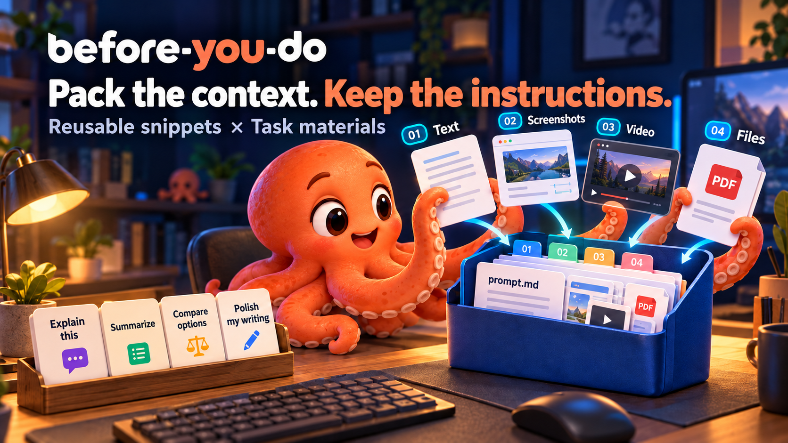
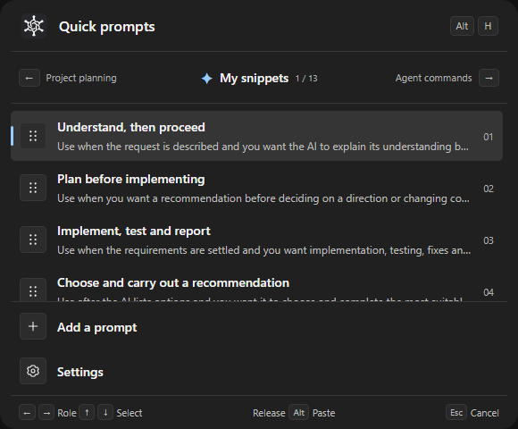
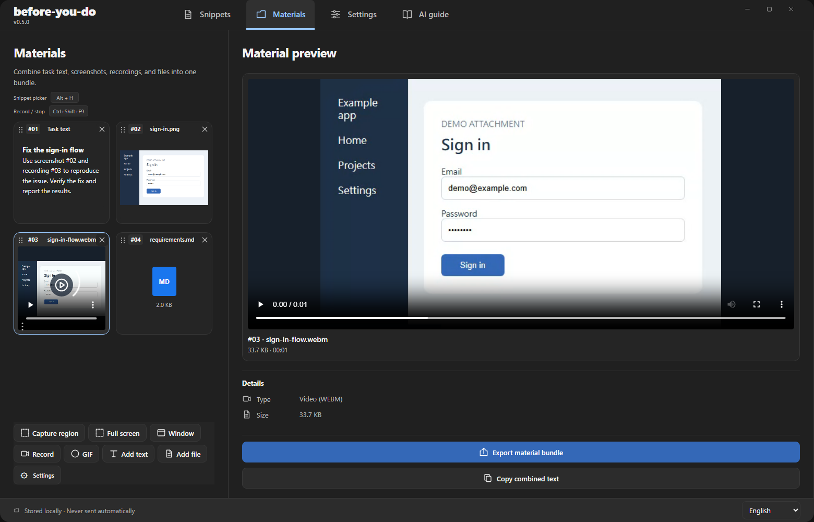

<h1 align="center">before-you-do </h1>

  <b>One more instruction, before AI gets to work.</b> 
  Add a reusable instruction, or gather this task’s text, images and files in one place.

  
  
  
  
  
  
  
  

English · <a href="README.zh-TW.md">繁體中文</a>

Tired of retyping “plan first” and “test your changes,” or pasting screenshots one by one? before-you-do reduces repeated typing and context gathering so you can hand AI a clearer request.

## 1. Add an instruction

Save the reminders you use repeatedly, then add the right one to your conversation:

> “Summarize your understanding, then proceed.” 
> “Only change what is necessary. Avoid unrelated refactoring.” 
> “Test the main flows and report the results.”

1. Write your request in the AI chat and leave the cursor where you want the instruction.
2. **Hold Alt, then press H.** Use **Left/Right** for roles and **Up/Down** for snippets.
3. **Release Alt to paste.** Review the message and send it yourself.

Customize snippets, usage scenarios, their order and the shortcut.

## 2. Gather this task into a bundle

For example, a login bug needs two screenshots, a short recording and a written description:

1. Open **Materials** and add text, images and files. You can also capture screenshots or recordings.
2. Drag a card or its image into order and refer to items as **#01, #02…** in your request.
3. **Export material bundle** and share the task text and attachments with your AI.

Right-click a material or open its three-dot menu and choose **Copy**: images copy as images, text copies as text, and GIFs/videos/files copy as attachments. Text drafts are saved before copying.

The export contains <code>prompt.md</code>, attachment copies and <code>manifest.json</code>. **Copy combined text** copies text and attachment references instead.

Hold **Alt+K** to open quick materials, then release Alt to paste the current workspace bundle. The receiving app must support multiple-file paste; otherwise use export. The app never sends your message automatically.

**Save material pack** takes one click and uses the local date and time, with a suffix for same-second collisions. The Load dialog provides Cancel, Delete, Add and Replace; loading asks before replacing current materials. Clearing the workspace leaves saved packs unchanged, and can be undone.

## Download and get started

**[Download the latest release](https://github.com/jaylooloomi/before-you-do/releases/latest)** — Windows x64, Mac Apple Silicon and Mac Intel.

- **Windows:** extract the entire ZIP, keep its DLLs beside <code>before-you-do.exe</code>, then launch it. WebView2 Runtime is required.
- **Mac:** builds are available but still await hardware testing and are unsigned/unnotarized. Screenshots require macOS 14+ and screen capture permission. Recording is currently Windows-only.
- **Upgrading:** save drafts in every role, fully quit the old app from the tray, then replace it. Keep your existing data folder. Automatic updates are not available.

Data stays local and no API key is needed. You choose the AI, review the content and send it yourself.

**v0.6.0:** keep separate [saved material packs](docs/task-packs.md) and [annotate or redact images](docs/image-editor.md). Back up your materials before upgrading: the new material-pack format cannot be opened by older versions.

## Keyboard essentials

| Action | Shortcut |
|---|---|
| Open the picker, then paste | Hold Alt and press H; release Alt |
| Switch roles / select snippets | Left/Right and Up/Down |
| Cancel | Esc, or press H again |
| Save the current role’s snippets | Ctrl+S |

Manage all shortcuts in the **Shortcut** tab. On Mac, use Option and Command+S.

The [user guide](docs/USER_GUIDE.md) covers role templates, capture and recording, shortcut settings, AI-assisted snippet editing, backups and development. Screenshots use the current source and demo data; release differences and platform limits are noted in the guide.

[MIT License](LICENSE) · [Template sources and licensing](docs/USER_GUIDE.md#template-sources-and-licensing)

### Quick materials

New-install defaults: **Alt+J** captures a region, **Alt+L** records video and **Alt+K** opens quick materials. Other material bindings start disabled; upgrades retain custom settings. Inside the main window, the quick-materials shortcut only hides it. In other apps, press **Alt+K** to toggle the compact list. Hold the modifier: ↑/↓ selects materials, ←/→ selects Paste all, Clear or Open main window. Release Alt (or the configured modifier) to run the selected action and close the panel (Paste all by default); Esc cancels. Enter previews. The paste-all shortcut starts disabled; assign one (such as Alt+V) if needed. Configure both bindings in **Shortcuts**.

After taking a screenshot, a thumbnail appears briefly in the lower-right corner of the captured monitor without taking keyboard focus.

Attachment-only pasting does not add `prompt.md`. Mixed text and attachments include it; text-only materials paste directly. Releasing the modifier with no materials closes the quick panel. Clear requires confirmation and supports undo; saved bundles are unchanged.
