<p align="center"></p>

<h1 align="center">before-you-do</h1>

<p align="center">
  <b>One more instruction, before AI gets to work.</b><br>
  Hold <code>Alt + H</code>, choose a snippet, release to paste. Describe the task, then add how you want AI to approach it.
</p>

<p align="center">
  Tired of repeating reminders while your system prompt keeps growing?<br>
  Save “Test your changes,” “Only edit the requested parts,” and “Polish my writing” as reusable snippets.<br>
  Add requirements, guidelines and limits to your conversation when needed, without retyping them.
</p>

<p align="center">
  
  
  
  
  
  
  <a href="https://github.com/jaylooloomi/before-you-do/actions/workflows/build.yml"></a>
  <a href="README.zh-TW.md"></a>
</p>

<p align="center">
  English · <a href="README.zh-TW.md">繁體中文</a>
</p>

<p align="center">
  <a href="#use-cases">Use cases</a> ·
  <a href="#quick-start">Quick start</a> ·
  <a href="#installation">Installation</a> ·
  <a href="#keyboard-controls">Keyboard controls</a> ·
  <a href="#faq">FAQ</a>
</p>

<p align="center">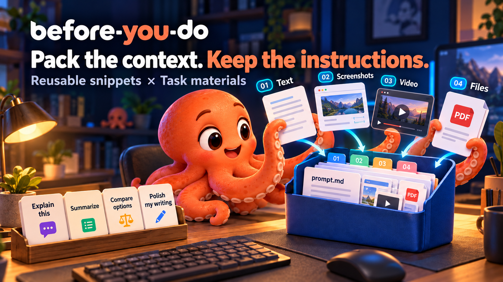</p>

<p align="center"><sub>Product illustration. Alt+H inserts snippets; exported materials are attached manually. Nothing is sent automatically.</sub></p>

Save the instructions you keep repeating to AI — “plan first,” “change only what is necessary,” or “test it before reporting back” — and insert them after writing your request. No API key, AI account or AutoHotkey required, and no dependency on a particular model.

**It pastes; you send.** You choose when to add an instruction and which one to use, and can edit it before sending. Prompts express your expectations; they do not guarantee that AI will follow them.

## Two modes, one clearer AI handoff

Describe **what** you need. Keep reusable instructions for **how** AI should work, and gather the supporting material for **this task**.

| Mode | Use it when | What you do |
|---|---|---|
| **Reusable snippets** | You keep repeating “plan first,” “test it,” or “stay in scope” | Save the instruction, hold **Alt+H**, choose a role/snippet and release to paste |
| **Task materials** | Your request needs screenshots, a recording, notes or files | Collect the items, arrange their order and export one local bundle |

**Example:** a login bug needs two screenshots, a short recording and a requirements file. Add a task description, arrange the materials as **#01, #02…**, then refer to those numbers in your request. Export the bundle and attach its contents to your AI chat. Add “Implement, test and report” from your snippets when you want AI to carry the work through.

### Four tabs

| Tab | Main tools |
|---|---|
| **Snippets** | 13 roles including My snippets, Agent commands, Development, Writing and Project management; scenarios, search, ordering, default-role star, editing and saving |
| **Materials** | Region/full-screen/window screenshots, Windows silent video/GIF, text/files, numbered drag sorting, previews, double-click to open with the default app, combined text and bundle export |
| **Settings** | Snippet shortcut, four interface languages, light/dark/system theme and sign-in startup |
| **AI guide** | Template library, AI editing instructions, current-role JSON import/export, data paths and backup guidance |

**Recent interface updates:** consistent page-title positions, cards and controls; separate Settings and AI guide tabs; shorter help copy; and the version below the app name. The current source also includes left-aligned material shortcut hints and a reserved **Delete / Save snippets** action area that stays visible while editor content scrolls. Those last two adjustments are newer than the v0.5.0 download.

**Two separate actions:** **Alt+H** pastes a saved snippet; **Export material bundle** creates local files. Copy combined text includes attachment references, not the images or file bytes. Attach the exported files yourself, review the message and send it when ready.

## Screenshots and new workflows

These screenshots render the committed frontend with isolated demo data, not personal snippets or desktop captures. They show the current source interface; the two post-v0.5.0 UI adjustments noted above are not yet in the published download. [Capture manifest](docs/images/current/capture-manifest.json).

### Collect, number and preview task materials

Add task text, screenshots, a recording and a requirements file. Drag cards to change their order; **#01, #02…** stay consistent between cards, the selected preview and the exported bundle. Select a video to play or seek it in the preview. Double-click an attachment to open it with your default application.

<p align="center">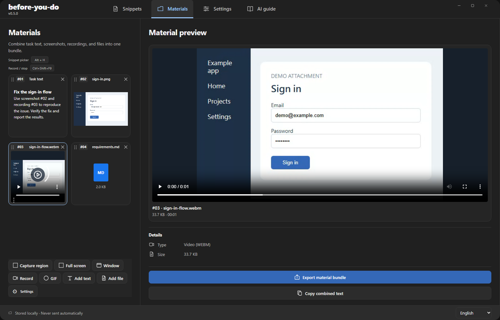</p>

**Copy combined text** copies the task text and attachment references. **Export material bundle** creates the files for you to attach manually; neither action sends a message to AI.

<details>
<summary>Capture, recording, text and file shortcuts</summary>

In **Materials → Settings**, each action sits beside its shortcut field. Customize region/full-screen/window capture, video, GIF, **Add text** and **Add file**. The image uses example Ctrl+Shift+F6–F12 bindings; choose available keys on your computer. Auto detection and the pixel magnifier can also be toggled here.

<p align="center">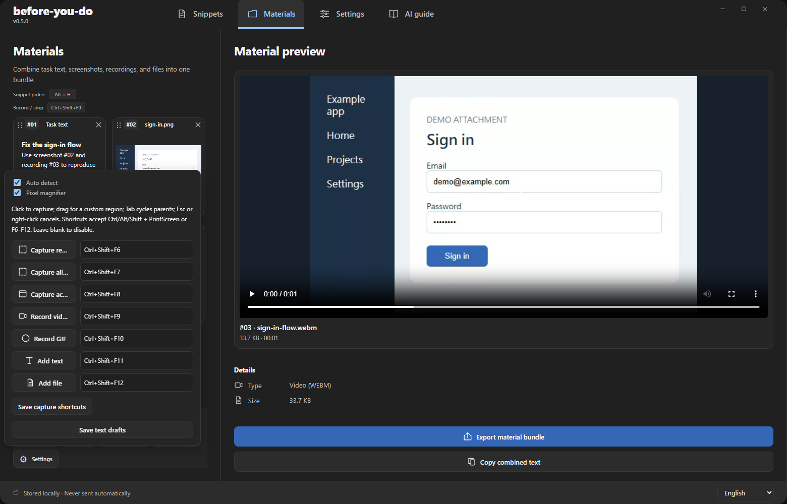</p>

</details>

<details>
<summary>Settings: shortcut, language, appearance and startup</summary>

The standalone **Settings** tab controls the snippet picker shortcut, four interface languages, light/dark/system appearance and sign-in startup. These preferences are separate from the capture shortcuts in Materials.

<p align="center">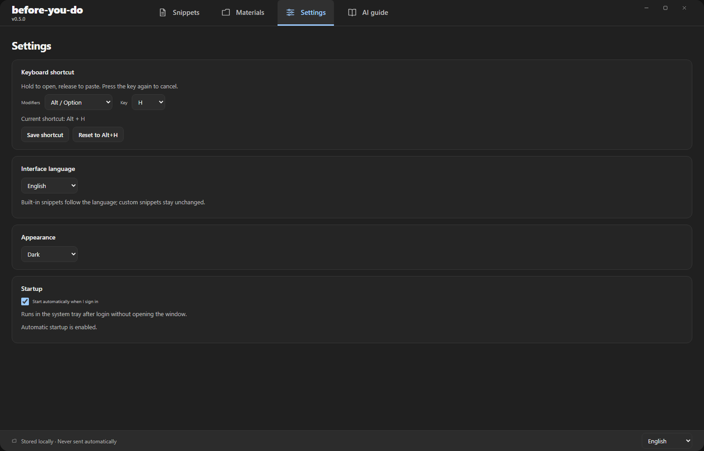</p>

</details>

<details>
<summary>AI guide: templates, editing instructions and JSON import/export</summary>

Choose a template and add it as a draft without replacing existing snippets. Copy instructions for a local-file AI or a regular chat AI. The guide also shows the current role's data path and backup guidance.

<p align="center">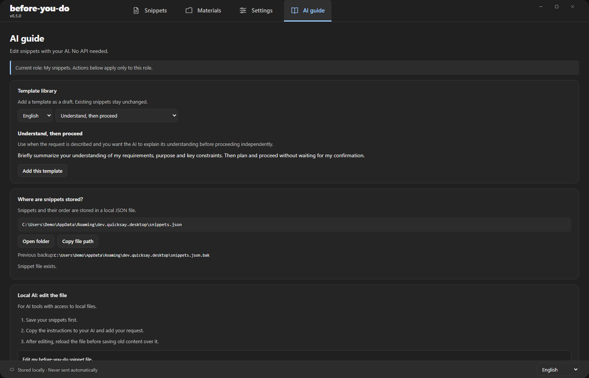</p>

For a chat AI, copy the saved snippets, ask for edits, paste the complete JSON and select **Validate & apply JSON**. Applying replaces this role's snippets, order and drafts after a backup and confirmation. **Copy snippets as JSON** exports saved entries only, excluding unsaved drafts.

<p align="center">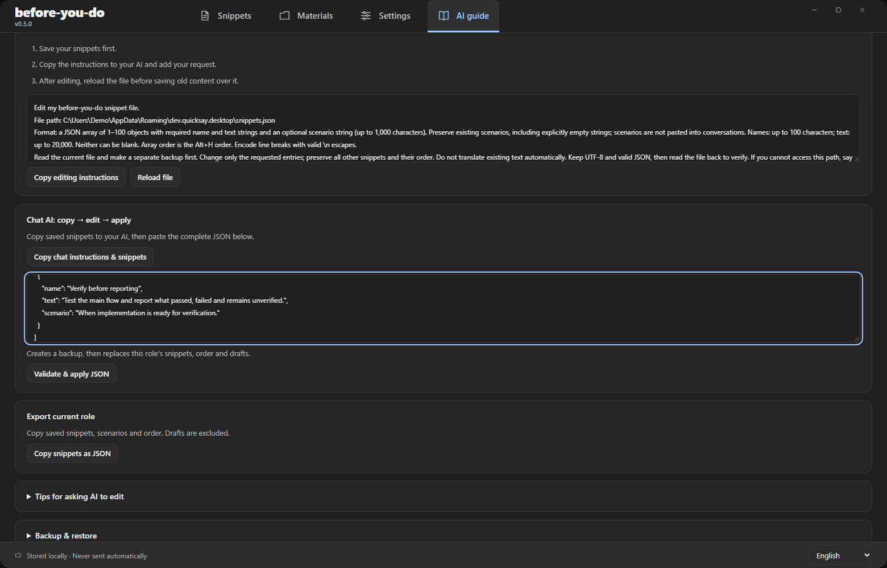</p>

</details>

## Prompt workspace (v0.5.0)

**v0.5.0:** Four tabs — Snippets, Materials, Settings and AI guide — now share consistent titles and controls. The current version appears below the app name. Materials supports screenshots, Windows silent recording/GIF, editable text, files, drag sorting, numbered exports and video previews. Existing snippets and the Alt+H workflow remain available.

Open the **Materials** tab to collect a one-off task separately from your reusable snippets:

1. Capture a region, all screens, or the last other application window you used (**Windows; macOS 14+**, with Mac hardware validation still pending).
2. Add editable task text and local files. PNG, JPEG, GIF and WebP images have previews.
3. Move materials up/down or remove individual items. Text changes are saved locally; a local recovery draft also protects edits before autosave completes.
4. **Copy combined text** copies text and attachment references. **Export material bundle** writes `prompt.md`, the attachment copies and `manifest.json` to a new folder. Attach those files to your AI conversation yourself.

The region selector prepares the desktop image and cursor magnifier before revealing the window, so the magnifier is available immediately without another mouse movement.

**Smart region selection:** hover to highlight a window or native control with a dashed outline, then click to capture it. Drag to select any rectangle instead. Tab / Shift+Tab cycles between the detected control and its parent window; Escape or right-click cancels. A pixel magnifier and X/Y/W/H readout help with precision. Automatic detection and the magnifier can be toggled under Capture shortcuts and options in the workspace. No toolbar covers the frozen screen. Windows detects native controls; macOS detects windows. Custom-drawn web content may require manual selection.

The existing Alt+H snippet workflow is unchanged. There is no background clipboard monitoring, automatic upload, or automatic sending. Each file is limited to 25 MB, attachments to 100 MB total, and each session to 100 items. Windows window capture records visible desktop pixels; covered content may be absent. macOS uses a desktop-independent ScreenCaptureKit window filter. macOS 11–13 can still use snippets and text/file materials, but screenshot buttons are disabled. On macOS 14+, explicitly allow screen capture using the workspace button, then check access again. Refused or revoked access never disables your text/file materials.

**Inline video playback:** existing WebM recordings and supported MP4 attachments show a player with play/pause, seeking and volume controls. Videos do not autoplay. If the system cannot decode a clip, export the bundle and open it in an external player.

**Windows capture shortcuts:** Shift+PrintScreen selects a region, PrintScreen captures all screens, and Alt+PrintScreen captures the last external window. Ctrl+Shift+PrintScreen selects a region for silent WebM recording; Ctrl+Alt+Shift+PrintScreen selects a region for GIF. Press a recording shortcut again to stop, or use **Stop recording** in the system tray. Shortcut captures save to the workspace without opening the manager. Alt+H remains independent.

Open **Capture shortcuts and options** in the workspace to change these keys (PrintScreen or F6–F12, with Ctrl/Alt/Shift), or leave a binding blank to disable it. Close competing capture tools or change the bindings if Windows reports a registration conflict. No conflicting key is silently taken over.

Recording currently supports **Windows only**, without audio: WebM at 15 fps, GIF at 10 fps, up to 120 seconds and 25 MB. Use **Install recording component** once to download the pinned ~82 MB FFmpeg LGPL shared runtime; the SHA-256 must match before use. A green dashed border marks the live recording region. A compact nearby bar provides Stop, Pause/Resume, Cancel and an elapsed timer. The border turns yellow while paused; paused time is excluded by recording separate segments and joining them on completion. Cancel discards the session. Border and controls are excluded from capture. A short original completion sound plays only after the material is saved successfully. The system tray icon also gains a red badge while recording. Exit waits for finalization; failed outputs remain at the displayed recovery path. See [runtime sources and license](docs/THIRD_PARTY_RECORDING.md). Mac screenshots remain available; recording and these new global shortcuts are not yet supported on Mac.

Materials live in `prompt-materials/` beside the snippet data file, with a separate `session.json`, managed `files/` copies, and `exports/`. Removing a source file after importing does not remove its managed copy. Exports remain after individual materials are removed. The Materials workspace is included in v0.5.0.

## Use cases

My snippets includes six common working instructions; Agent commands contains twelve terminal commands and shortcut reminders for Claude Code, Codex, Antigravity and OpenCode. Additional roles provide snippets for development, writing, research and other tasks, each with a usage scenario. Use them as they are or rewrite them in your own voice.

| Your situation | Choose this template | What you want AI to do |
|---|---|---|
| Your request is a little vague and you want it to explain its understanding first | **Understand, then proceed** | Briefly restate the requirements, purpose and constraints, then plan and proceed |
| You are discussing options and do not want code changes yet | **Plan before implementing** | Recommend an approach with reasons, stopping at the planning stage |
| The requirements are settled and you want implementation and verification | **Implement, test and report** | Implement, test the main flows, fix bugs, retest, and report results and anything unverified |
| AI has listed several options and you want it to make the call | **Choose and carry out a recommendation** | Choose a suitable approach, explain why, and carry it out |
| You need a small fix without an unrelated overhaul | **Change only what is necessary** | Preserve working behavior and avoid extra refactoring or scope expansion |
| AI says it is finished and you want evidence that it works | **Show it working** | Exercise the main flows, taking and inspecting screenshots where appearance matters |

For example, when you only want to discuss the approach, add:

> Do you understand what I mean? Plan it out and give me your recommended approach and reasons. Do not implement it yet.

Once you are ready to proceed, choose “Implement, test and report” instead. **The same task can need a different instruction depending on how far you want AI to take it.**

You can also add your own snippets, such as “Use Traditional Chinese and lead with the conclusion” or “Explain the tradeoffs before recommending an approach.” It works with web and desktop text fields that accept ordinary paste; compatibility varies by application.

## Quick start

Suppose you want to add language support:

1. Write your request in the AI chat box, insert a newline, and leave the cursor where you want the extra instruction.
2. **Hold Alt, then press H** to open your snippets.
3. Keep holding Alt, use **← / →** to choose “My snippets,” then **↑ / ↓** to select “Implement, test and report.”
4. **Release Alt** to paste the snippet into the original input field.
5. Review the text and send the message yourself.

```text
You write:
Add language support.

Alt + H → choose “Implement, test and report” → release Alt

Your chat box now contains:
Add language support.
Plan and implement this, then test the main user flows. Fix any bugs and retest.
When finished, report what you tested, the results, and anything still unverified.
Do not wait for my confirmation at every step.
```

<table>
<tr>
<td align="center" width="50%"><strong>My snippets</strong><br>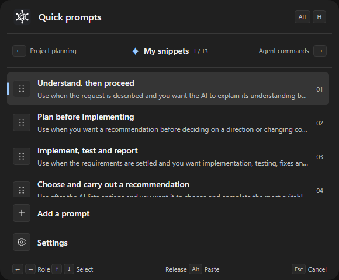<br><sub>Everyday instructions and verification</sub></td>
<td align="center" width="50%"><strong>Project planning</strong><br>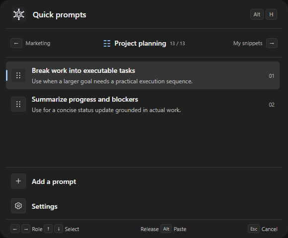<br><sub>Break down work and track blockers</sub></td>
</tr>
<tr>
<td align="center" width="50%"><strong>Development</strong><br>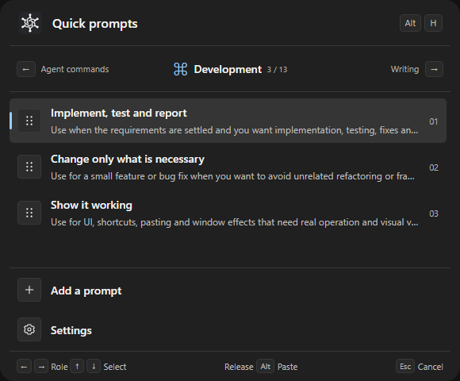<br><sub>Implementation, debugging and testing</sub></td>
<td align="center" width="50%"><strong>Marketing</strong><br>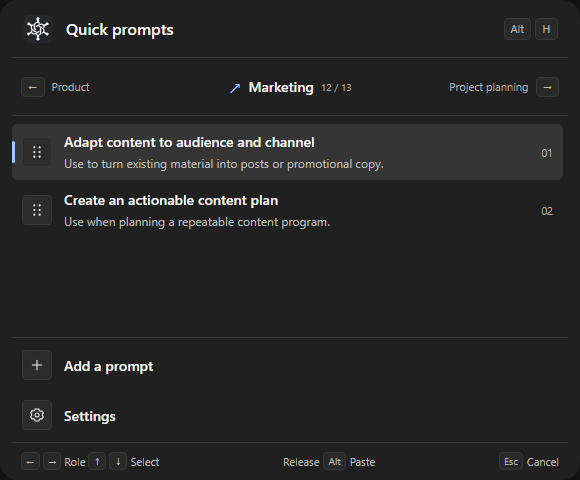<br><sub>Adapt content and plan topics</sub></td>
</tr>
</table>

The picker preserves focus in the original input field. Its role bar shows the current role, position and neighboring roles; Add and Settings remain fixed below the list. The examples show My snippets, Project planning, Development and Marketing. Use Left/Right to switch roles. Selecting Settings and releasing the modifiers opens the snippet manager. The app supports four interface languages. You review and send pasted messages yourself.

## Installation

**Latest feature release: [v0.5.0](https://github.com/jaylooloomi/before-you-do/releases/tag/v0.5.0).** Built-in prompts follow your language while custom snippets keep their text. Includes startup recovery, consistent emoji limits, safer JSON tools and external-file conflict protection. [Release notes](docs/releases/v0.5.0.md) · [Release process](docs/RELEASING.md).

### Windows

> Role switching and editable usage scenarios are included in v0.3.0 and later. Save your edits and fully quit the old app before upgrading; existing snippet files are preserved.

Download the **Windows x64 portable ZIP** from [Releases](https://github.com/jaylooloomi/before-you-do/releases/latest). macOS Apple Silicon and Intel archives are also available, but have not been tested on real Mac hardware. These builds are unsigned.

The source repository does not include executables. Check successful [GitHub Actions builds](https://github.com/jaylooloomi/before-you-do/actions) for available build artifacts, or build the app yourself using the instructions below.

After obtaining a Windows build:

1. Extract its files into the same folder. If `WebView2Loader.dll` is included, keep it beside the executable.
2. Make sure Microsoft Edge WebView2 Runtime is installed.
3. Fully quit older versions or any AHK script using Alt+H, then launch the new version.
4. Save your snippets and try Alt+H in an AI chat box.

The Windows executable is `before-you-do.exe`. Automatic updates are not currently available.

To start automatically at sign-in, open **Settings → Startup → Start automatically when I sign in**. This is enabled by default on first use; turning it off is remembered on later launches. Login startup runs in the system tray without opening the manager; launching the app normally still opens it. Windows uses a per-user Run registry entry; macOS uses a LaunchAgent. No administrator permission is required. If you move the portable app, turn the setting off and on again; turn it off before removing the app. OS Startup settings and device policies can override these entries.

Closing the manager window hides the app; the shortcut remains available. To exit completely, choose “Quit before-you-do” from the system tray menu.

The manager, including its settings page, stays on top of normal windows while open. Close it to hide it in the tray; sign-in startup keeps it hidden.

### macOS and other platforms

Native Option+H and paste handling, plus Apple Silicon and Intel build configurations, are included. **macOS still needs testing on real hardware**, and signing and notarization are not provided. Allow Accessibility access and, if required, Input Monitoring. A Windows exe does not run on macOS.

Linux, phones, tablets and browser extensions are not currently supported.

## Keyboard controls

In the **snippet manager**, use **← / →** to switch roles and **↑ / ↓** to select snippets. Navigation wraps and follows the visible search results. Each role retains its drafts and selection. When editing text, using a select control, viewing settings or a dialog, or waiting for a save/role load, arrows keep their normal behavior instead of navigating the manager. Selecting a snippet here does not paste or save it.

When the manager has keyboard focus, the shortcut only hides it: no picker opens and nothing is pasted. Unsaved drafts stay in the app. Focus an external input and press the shortcut again to select a snippet. When invoked from an external app, the manager is hidden before the picker opens.

The table uses the default **Alt+H**. Change it under **Settings → Keyboard shortcut**. The picker updates its hints; pressing your newly configured key a second time cancels it.

| Key | Action |
|---|---|
| **Hold Alt, then press H** | Open the picker from an external input; keep holding Alt |
| **← / →** | Browse the previous / next role; selection resets to its first saved snippet |
| **↑ / ↓** | Select a snippet; wrap around the list, including the Add and Settings rows |
| **Release Alt** | Paste the selected snippet, create a draft if Add is selected, or open the snippet manager if Settings is selected |
| **Press H again while the picker is open** | Cancel and close; releasing Alt afterward does not paste |
| **Esc** | Cancel and close |
| **Ctrl + S** | Save all valid snippets in the current role; drafts in other roles are not saved together |
| **/** | Search in the manager, unless you are editing text |

- Put your most-used snippet first: **a quick press and release of Alt+H pastes the first snippet**.
- The picker uses keyboard navigation rather than mouse selection to preserve the original input position.
- Holding H does not accidentally close it through key repeat; cancellation requires a fresh keypress.
- On macOS, use **Option ⌥ + H** and **Command + S**. These still await testing on Mac hardware.

## Make the instructions your own

The bottom of the Alt+H picker contains “Add a prompt” followed by “Settings.” Select Settings and release the shortcut modifiers to open the **snippet manager**, without pasting text or creating a draft. Use the top **Settings** tab for app preferences and **AI guide** for templates and JSON workflows.

On Windows, selecting Settings or Add opens the manager on the original input window's display, fitted to that display's work area. Normal tray opening retains its usual placement.

While holding the shortcut modifiers, use **← / →** to browse roles and **↑ / ↓** to select a snippet. The role bar shows neighboring roles and the current position. Releasing commits the selected role; Esc or the second trigger key cancels without changing the active role. Unsaved manager drafts are preserved.

### Role cards and separate snippet lists

Browse **13 roles** using the horizontal cards, left/right buttons, mouse wheel or horizontal trackpad gestures. Your existing snippets stay in My snippets. Each other role has its own list, which you can edit, add to, delete from and reorder independently.

| Role | When to use it | Default snippets |
|---|---|---|
| My snippets | General instructions: clarify, plan, execute and report | 6 |
| Agent commands | Claude Code, Codex, Antigravity and OpenCode reminders | 12 |
| Development | Implement features, limit scope and demonstrate working results | 3 |
| Writing | Polish drafts, adapt tone and get ready-to-use text | 3 |
| Research | Verify facts, compare options and find blind spots | 3 |
| UI design | Define visual rules and inspect states and screen sizes | 2 |
| Frontend | Build interactive interfaces and measure performance bottlenecks | 2 |
| Backend | Define API contracts and check failures and recovery | 2 |
| Code review | Find actionable issues and neighboring regressions | 2 |
| QA testing | Run acceptance checks, reproduce bugs and retest fixes | 2 |
| Product | Turn ideas into requirements and prioritize features | 2 |
| Marketing | Adapt content to an audience and plan concrete topics | 2 |
| Project planning | Break down work, dependencies, progress and blockers | 2 |

The Agent commands role, between My snippets and Development, includes Claude Code, Codex, Antigravity and OpenCode commands and shortcut reminders. OpenCode examples include `opencode --auto`, `/sessions` and `[Tab]` for Build / Plan mode. These are pasted as text, never executed by the app. Existing saved lists are not reset or automatically expanded on upgrade; add them from the template library if needed.

Counts describe the initial presets; upgrading does not reset edited content. Roles organize snippets. They do not call AI or execute tasks inside the app.

<p align="center">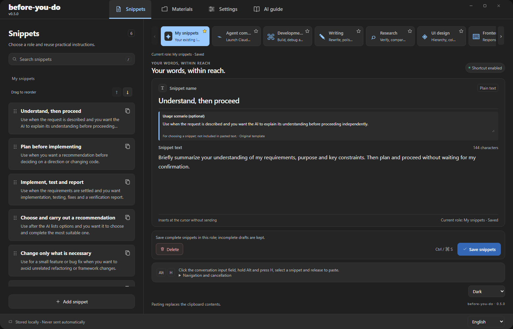</p>

The current manager keeps role cards above the editor, marks the default picker role with a star, and reserves a separate bottom area for **Delete / Save snippets**. Long editor content scrolls without moving those actions out of view.

Alt+H uses the active role’s **saved** snippets. Switching preserves each role’s unsaved edits and selection in the current app session, and remembers the active role across restarts. Save edits before quitting. Imports, reloads and AI editing instructions apply only to the active role.

My snippets keeps using `snippets.json`. Other roles use `snippets-<role ID>.json` in the same folder, such as `snippets-developer.json`, `snippets-designer.json` and `snippets-product.json`. Each has a corresponding `.json.bak` backup. The active role is stored separately in `roles.json`; settings show the actual file path for the current role.

### Add a usage scenario

When creating or editing a snippet, use the optional **Usage scenario** field below its name to describe when to use it (up to 1,000 characters). Alt+H displays it as a selection hint; pasting inserts only the snippet content. Save to retain it. JSON imports and AI editing instructions support the optional `scenario` field alongside `name` and `text`. Existing files still work. Built-in hints appear until you customize the scenario; clearing a customized scenario removes that hint.

For example, a scenario can say “Use after implementation, when the main workflow needs testing.” Store it separately from the instruction:

```json
[
  {
    "name": "Test and report",
    "scenario": "Use after implementation, when the main workflow needs testing.",
    "text": "Test the main workflow, fix any bugs and retest. Report what you tested, the results and anything still unverified."
  }
]
```

### Customize the shortcut

The default is **Alt+H**. In **Settings → Keyboard shortcut**, choose Alt / Option or Ctrl, optionally add Shift, and select A–Z, 0–9 or Space. Click **Save shortcut** to apply it immediately and keep it across restarts. You can also reset it to Alt+H.

For example, with **Ctrl+Shift+J**, hold Ctrl+Shift and press J, select with ↑ / ↓, then release the modifiers to paste. Press J again while the picker is open to cancel. On Windows, if the new combination is already registered, the app retains your previous shortcut and settings. On macOS, avoid combinations used by other apps. Common Ctrl editing combinations, such as copy, paste and save, cannot be assigned.

### Choose an interface theme

Choose **Follow system**, **Light** or **Dark** from the theme selector at the bottom of the manager. New installations follow the operating system; an existing saved theme choice is kept when upgrading. Follow system updates when your operating system switches between light and dark appearance.

### Add, edit and reorder

Click “Add snippet” in the manager, enter a name and content, then click “Save snippets.” Or select “Add a prompt” at the bottom of the Alt+H picker and release Alt to create a draft.

Search the sidebar, drag snippets to reorder them, or use their ↑ / ↓ buttons. **Once saved, the next Alt+H picker uses the updated content and order.** Unsaved edits do not change the picker.

Each role supports 1–100 snippets, with up to 100 characters per name and 20,000 per content field.

**Saving applies to the current role.** In v0.3.1 and later, complete snippets save even when other drafts are incomplete. Incomplete drafts stay in the editor; the attention list names each affected snippet and field. Click an entry to select it and focus the field that needs work. If an existing saved snippet is edited into an incomplete state, its previous saved version remains in the file and shortcut picker. A new incomplete draft is not added to the picker. If there are no complete snippets or previous versions to retain, nothing is written.

**Unsaved changes are tracked per role.** Role cards show an unsaved marker, and the overview names other roles with pending edits. Saving one role does not save the others. On a normal app exit, a confirmation lists all unsaved roles. Cancel to return and save them, or explicitly discard the changes and exit. Closing the manager window still hides it and keeps the app running.

Drafts remain in memory until completed and saved. They are not automatically restored after an explicit discard, forced termination or system failure.

### Four interface and template languages

In Settings, choose **繁體中文, 简体中文, English, 日本語**, or follow the system language. Switching updates the manager and picker immediately and remembers your choice. Unsupported system languages fall back to English.

**Unmodified built-in snippets follow the interface language**, including their names, bodies and the text pasted by the picker. Switching languages does not rewrite the saved JSON. Added, imported or customized snippets keep their original text, including unsaved drafts. Legacy built-ins are recognized only by an exact match of both name and body with no custom scenario. The template library also offers four language versions; “Add this template” appends a personal draft without replacing your list.

### Use your own AI to edit snippets

AI guide provides two workflows without connecting the app to an AI service:

- **Chat-based AI:** Copy the instructions and saved snippets, ask your AI to edit them, then paste the complete JSON back into settings. The app validates it and, after your confirmation, applies it and backs up the previous file.
- **AI with local file access:** Copy the editing instructions containing the actual file path. Have your AI back up and edit the file, then click “Reload file” in the app so stale editor content does not overwrite the updated file.

Importing and reloading replace the current role’s list and unsaved drafts. Preserve any edits you need first. An ordinary web chat cannot read or write local files just because you give it a path.

## Why this exists

Every new conversation often repeats the same working preferences: “explain your understanding first,” “plan without implementing,” or “tell me what you tested.” Retyping takes time, and switching to a notes app interrupts your train of thought.

before-you-do keeps those instructions close at hand. Your task changes, but your preferred way of working can be reused across models and websites without installing an extension for each one.

The name echoes a family member calling out before you leave: “Wait — one more thing.”

## How it works

```text
Write your request
      ↓
Hold Alt + H → use ← → to choose a role → ↑ ↓ to choose an instruction
      ↓
Release Alt → paste at the original cursor position
      ↓
Review the text and send it yourself
```

The app remembers the target and displays a picker without taking focus. After you release Alt, it inserts text using the system clipboard and paste operation. If the target changes, it cancels the paste. Choosing Add opens a draft; choosing Settings opens the snippet manager. Neither pastes text.

This is a local text tool. It does not read your AI conversations to select an instruction or send requests to a model.

## Compatibility and limitations

| Environment | Status |
|---|---|
| Windows | Selection, paste, cancellation and adding snippets tested on hardware |
| macOS — Apple Silicon / Intel | Native code and CI build configurations included; hardware testing pending |
| Linux, phones and tablets | Not supported yet |
| AI web and desktop input fields | Usable where ordinary text paste is accepted; not every application has been tested |

The default shortcut is Alt+H / Option+H and can be changed in settings. Cloud sync, rich text and automatic updates are not currently available.

## Where your data lives

Snippets are stored in a local JSON file. The app has no built-in cloud sync and does not send your snippets to AI on its own. You choose which service to paste them into; that service's data handling applies once you send the text there.

| Platform | Snippet file |
|---|---|
| Windows | `%APPDATA%\dev.quicksay.desktop\snippets.json` |
| macOS | `~/Library/Application Support/dev.quicksay.desktop/snippets.json` |

Shortcut settings are stored separately in `shortcut.json` in the same folder. AI guide shows the actual paths and lets you open the folder. Saving retains each role’s previous version in its corresponding `.json.bak` file; this is not a full version history. Before restoring, quit the app, keep a separate copy of the current file, then copy that role’s backup to the original file name shown in settings.

The app was previously named QuickSay. Its `dev.quicksay.desktop` identifier, data paths and preferences remain unchanged to preserve existing data. Legacy WPF XML compatibility still reads `%APPDATA%\QuickSay\settings.xml`.

**Pasting overwrites the system clipboard; its previous contents are not automatically restored.** Snippet files and clipboard contents are not encrypted. Clipboard history and sync tools may also retain them.

## FAQ

**Do I need an AI subscription, API key or AutoHotkey?**

No. The app saves and pastes text you prepare. It does not call AI models or depend on AHK.

**Does it automatically add instructions to every conversation?**

No. You choose when to open the picker, which snippet to use and when to send. You can edit the text after pasting.

**What if Alt+H does nothing?**

Check the shortcut status in the manager, quit older versions or apps using the same combination, then choose “Enable shortcut again.” On macOS, also check Accessibility and Input Monitoring permissions. You can choose another shortcut in settings if the current one conflicts with another app.

**Why does Alt+H only hide the manager when I am working inside it?**

This prevents pasting a snippet back into the app’s own editor. Your drafts remain in the app. Focus an external chat box, then press the shortcut again to choose a snippet.

**Why does canceling return to the previous role?**

Left/right navigation temporarily previews a role. Releasing the modifiers to paste, add a snippet or open the manager commits the role. Esc or a second trigger key cancels the operation.

**Why was nothing pasted?**

Make sure the cursor is in a field that accepts paste and both Alt and H have been released. Switching away from the original target cancels the operation. On Windows, an app running as administrator may reject paste input from a normally privileged app.

**Why is my new snippet missing from the picker?**

New entries are drafts. Fill in the name and content and save them before opening Alt+H again.

## Development and builds

Built with Tauri 2, Rust, HTML, CSS and JavaScript. Production builds embed the frontend resources in the desktop app.

Requirements: Node.js 22.12+ or 24+, Rust stable, MSVC C++ Build Tools, Windows SDK and WebView2 on Windows, or Xcode Command Line Tools on macOS. See the official [Tauri prerequisites](https://v2.tauri.app/start/prerequisites/).

```sh
git clone https://github.com/jaylooloomi/before-you-do.git
cd before-you-do
npm ci
npm run dev
```

Test and build:

```sh
npm test
npm run build:ui
cargo test --manifest-path src-tauri/Cargo.toml --locked
npm run build
```

The Windows executable is at `src-tauri/target/release/before-you-do.exe`; the macOS app is at `src-tauri/target/release/bundle/macos/before-you-do.app`. Use `npm run build -- --no-bundle` to build only the executable, or `--bundles app` on macOS.

<details>
<summary><b>Source guide and desktop integration tests</b></summary>

| Path | Contents |
|---|---|
| `src/main.js`, `src/style.css` | Manager interface and shortcut picker |
| `src/templates.json`, `src/template-locales.js` | Built-in templates, usage scenarios and four language versions |
| `src/locales.js`, `src/i18n.js` | Interface translations and language switching |
| `src/settings.js`, `src/ai-prompts.js` | Settings, AI instructions and import workflows |
| `src/roles.js`, `src/extra-role-presets.js` | 13 roles and their localized snippets |
| `src/role-defaults.json`, `scripts/generate-role-defaults.mjs` | Build-time defaults consumed by the native picker |
| `src-tauri/icons/`, `scripts/icons.py` | Conversation-and-snippet icon artwork and platform exports |
| `src-tauri/src/` | Native shortcuts, paste, storage and window handling |
| `tests/`, `scripts/` | Tests and build tools |

The desktop app, tray and title bar use the approved white interwoven symbol on a charcoal tile. [Icon master and design notes](docs/branding/app-icon.md).

GitHub Actions includes Windows and two Mac build jobs. A successful build does not verify real shortcut, focus and paste behavior on every platform. `scripts/test-windows.ps1` provides Windows desktop integration tests; it operates system keys and the clipboard, so run it during a dedicated testing session.

</details>

## Template sources and licensing

The eight specialist roles added after Research contain two short prompts each, adapted from [agency-agents-zh](https://github.com/jnMetaCode/agency-agents-zh). They include usage scenarios and source references. These are short insertable instructions, not the upstream full system prompts or an automatic multi-agent integration. The upstream [MIT license and attribution](docs/third-party/agency-agents-zh-LICENSE.txt) are preserved.

“Choose and carry out a recommendation” and “Change only what is necessary” draw on the [Get Shit Done execution workflow](https://github.com/gsd-build/get-shit-done/blob/main/get-shit-done/workflows/execute-plan.md). “Show it working” draws on the [Superpowers verification principles](https://github.com/obra/superpowers/blob/main/skills/verification-before-completion/SKILL.md). These are adaptations with translated versions, not verbatim text from the original authors.

Licensed under the [MIT License](LICENSE). Copyright © 2026 Arthur Wang. Third-party materials retain their respective licenses and attribution notices.

Agent commands also includes [Shift+Tab] as a Claude Code key reminder and /permissions for Codex. The shortcut reminder is pasted as text; no keypress is simulated.
