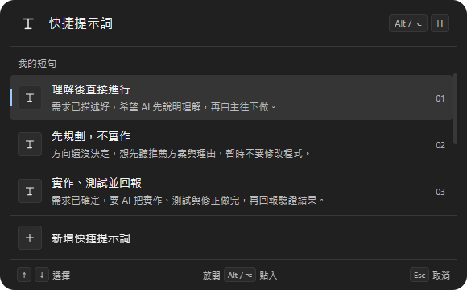
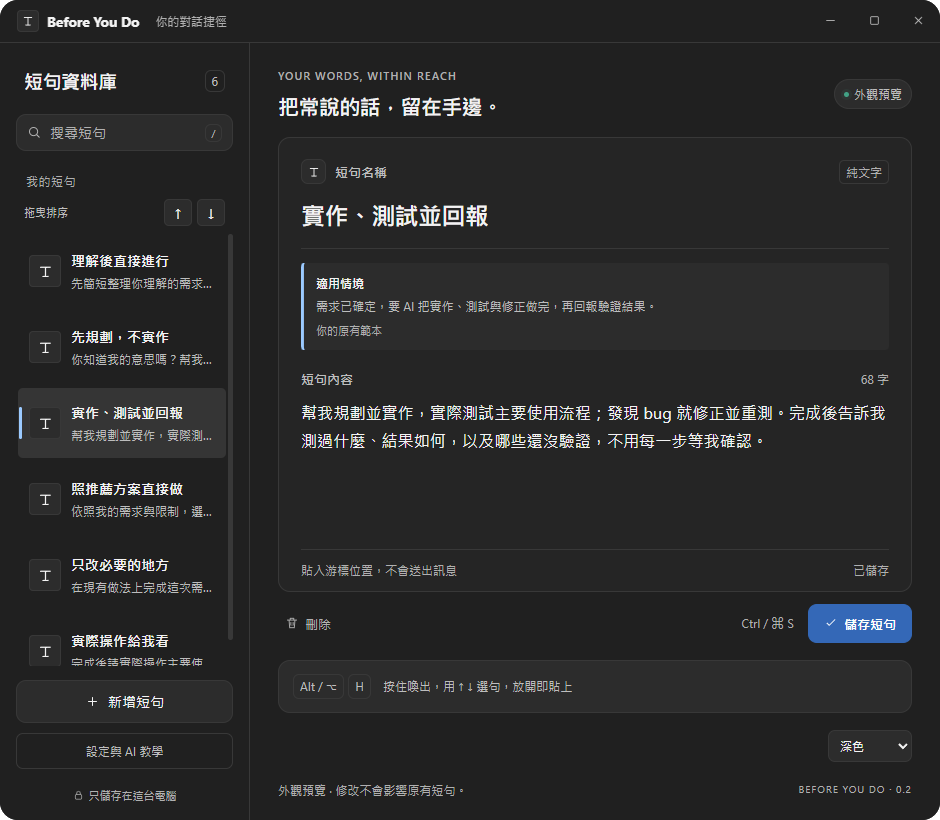

<h1 align="center">Before You Do</h1>

<p align="center">
  <b>動手之前，先聽完最後一句交代。</b><br>
  按住 Alt + H，挑一句，放開 Alt。把常用提示詞、工作交代與回覆文字，貼進正在輸入的地方。
</p>

<p align="center">
  
  
  
  
  
</p>

<p align="center"></p>

<p align="center"><sub>Windows 原生程式的預覽畫面，使用內建範本；視窗材質與圓角依作業系統而異。</sub></p>

Before You Do 是一個常駐桌面的文字快捷工具，以 **Tauri 2、Rust 與原生鍵盤事件**實作。使用時不需要 AutoHotkey、AI 帳號或 API Key，也不需要連線到文字生成服務。

它把你已經寫好的文字貼進輸入框，**不會自動送出訊息**。可以用在 AI 對話、郵件、筆記，以及接受一般貼上的文字輸入框。

## 使用情境

| 你經常做的事 | 短句例子 | 用法 |
|---|---|---|
| 請 AI 先整理理解，再開始工作 | 理解後直接進行 | 問題寫完，補上固定的工作方式 |
| 只想先聽方案 | 先規劃，不實作 | 明確交代這次的工作範圍 |
| 交付實作與驗證工作 | 實作、測試並回報 | 補上測試、修正與回報要求 |
| 經常交代輸出格式 | 使用繁體中文、先說結論、附驗證結果 | 在不同對話重複使用同一套偏好 |
| 回覆相似的工作訊息 | 收到，我會確認後回覆預計完成時間。 | 在郵件或訊息輸入框快速補入 |

> 提示詞可以幫你表達要求，但不能保證 AI 一定理解正確、完成測試或消除所有 bug。Before You Do 本身不分析對話，也不會替模型驗證結果。

## 安裝與啟動

### Windows：已有執行檔

**1. 把新版檔案放在同一個資料夾。**

若取得的版本附帶 `WebView2Loader.dll`，請讓它與 `BeforeYouDo.exe` 放在一起，不要只搬走 exe。

```text
Before You Do/
├── BeforeYouDo.exe
└── WebView2Loader.dll    # 隨版本附帶時需一併保留
```

電腦需要 Microsoft Edge WebView2 Runtime。一般 Windows 環境可能已安裝；缺少時請由 Microsoft 官方安裝 WebView2 Runtime。

**2. 結束舊版，再開啟 `BeforeYouDo.exe`。**

舊版 Before You Do 或 `QuickAsk.ahk` 可能占用 Alt+H。從系統匣圖示選單選「結束 Before You Do」，再開新版；主視窗的關閉按鈕只會收起視窗。

**3. 儲存一句短句，切到目標輸入框試用。**

先點好游標位置，再按住 Alt、按 H、用上下鍵選句，最後放開 Alt。

目前提供本機建置方式與 GitHub Actions 建置設定；這份文件不假設已有公開 Releases、已簽章的安裝程式或自動更新服務。尚無執行檔時，請看[開發與建置](#開發與建置)。

### macOS：目前需要自行建置

已有原生 Option+H 事件處理、Option 釋放偵測與 Command+V 貼入程式碼，並提供 Apple Silicon／Intel 的 CI 建置設定。

**macOS 尚未完成實機驗證，也尚未提供已簽章、公證的安裝包。** Windows exe 不能在 Mac 直接執行，請在 Mac 上依建置步驟產生應用程式。

首次使用需要在「系統設定 → 隱私權與安全性 → 輔助使用」允許 Before You Do；依系統提示，也可能需要「輸入監控」。授權後按「重新啟用快捷鍵」，必要時重新啟動程式。

## 使用

### 選一句，放開就貼入

1. 在管理視窗新增或編輯短句，按「儲存短句」。
2. 切到目標應用程式，點好文字輸入位置。
3. 按住 **Alt**，再按 **H**。Mac 對應 **Option ⌥ + H**。
4. 繼續按住 Alt／Option，用 **↑／↓** 選句。
5. 放開 Alt／Option，文字會貼入原輸入位置。

直接快速按下並放開 Alt+H，會貼入第一句。選單不取得鍵盤焦點，並停用滑鼠互動；請用上下鍵操作。

### 快捷鍵一覽

| 按鍵 | 功能 |
|---|---|
| Alt + H／Option + H | 喚出快捷選單，繼續按住 Alt／Option |
| ↑／↓ | 上下選句，到頂或到底時循環選擇，包含底部新增列 |
| 放開 Alt／Option | 貼入選取短句；若選到新增列，改為開啟新草稿 |
| 選單開啟時，再按一次 H | 關閉並取消，之後放開 Alt／Option 不貼入 |
| Esc | 關閉並取消 |
| Ctrl + S／Command + S | 在管理視窗儲存全部短句 |
| / | 在管理視窗聚焦搜尋；正在編輯文字時不攔截 |

長按 H 產生的鍵盤自動連發不會讓選單誤關閉。取消後若仍按住 Alt／Option，可以再按 H 重新開啟。

### 從選單新增提示詞

選單底部固定有「＋ 新增快捷提示詞」。選到它再放開 Alt／Option，就會開啟管理視窗，建立並選取一筆新草稿。

填入名稱和內容後，按「儲存短句」，下次喚出選單即可使用。新增動作不會貼入原輸入框；管理視窗中原有的未儲存編輯會保留。

### 調整排序

在左側清單直接拖曳短句，上下邊緣的指示線代表放置位置；也可以先選取短句，再按清單上方的 ↑／↓ 按鈕逐項移動。順序需按「儲存短句」才生效，Alt+H 選單與下次啟動會使用已儲存的順序；第一句也是快速按放 Alt+H 時會貼入的內容。

排序會保留正在編輯的文字與選取項目。搜尋中暫停排序，先清除搜尋即可繼續；空白草稿仍可移動，但不會寫入正式短句檔。

### 管理短句

<p align="center"></p>

- 左側搜尋會比對短句名稱與內容。
- 選取短句後，可在右側編輯名稱和多行文字。
- 修改與刪除需按「儲存短句」才會寫入檔案。
- 資料庫需保留 **1～100 句**；名稱最多 **100 字**，內容最多 **20,000 字**，名稱和內容都不能空白。部分 emoji 可能在前端計入多個字元。
- 收起管理視窗後，仍常駐系統匣／選單列；可從圖示選單再次開啟管理視窗或結束程式。

<details>
<summary><b>可直接使用的提示詞範例</b></summary>

全新資料庫預設提供六句範本；以下列出前三句。管理視窗會顯示適用情境與參考來源，Alt+H 清單也提供情境提示；實際貼入的只有提示詞正文。

**理解後直接進行**

```text
先簡短整理你理解的需求、目的與重要限制，再依此規劃並直接進行，不用等我確認。
```

**先規劃，不實作**

```text
你知道我的意思嗎？幫我規劃一下，直接給我你推薦的方案與理由，先不要實作。
```

**實作、測試並回報**

```text
幫我規劃並實作，實際測試主要使用流程；發現 bug 就修正並重測。完成後告訴我測過什麼、結果如何，以及哪些還沒驗證，不用每一步等我確認。
```

</details>

### 新增的工作方式範本

| 範本 | 適合什麼時候用 |
|---|---|
| 照推薦方案直接做 | AI 已提出幾個方案，希望它自行選擇並直接完成 |
| 只改必要的地方 | 修小功能或 bug，避免順便重構、換框架或擴大修改範圍 |
| 實際操作給我看 | 驗證介面、快捷鍵、貼上或視窗效果，要求實際操作與截圖 |

前兩句參考 [Get Shit Done 執行流程](https://github.com/gsd-build/get-shit-done/blob/main/get-shit-done/workflows/execute-plan.md)；第三句參考 [Superpowers 完成前驗證](https://github.com/obra/superpowers/blob/main/skills/verification-before-completion/SKILL.md)，再補上實際操作與截圖要求。均為繁中改寫，不是原作者原文。範本與情境說明集中在 `src/templates.json`；情境說明不會寫入剪貼簿。改名仍會保留提示；自訂修改正文後則隱藏原範本的情境提示，以免誤導。

### 外觀設定

主視窗預設為 940 × 820，縮短編輯區留白；啟動時依螢幕可用工作區與縮放比例縮小並置中，避免超出螢幕。較小螢幕、較長內容或更多短句仍可捲動。

管理視窗與快捷選單共用淺色、深色與跟隨系統主題，採用中性灰底色。Windows 停用原生模糊與陰影，避免圓角外的方形底層；因此不顯示玻璃透明度控制。macOS 材質效果仍待實機確認。

兩個視窗使用相同灰階背景、分隔線與選取狀態，並同步切換明暗主題；藍色僅用於操作按鈕與選取指示。

Windows 一般視窗採原生圓角裁切，最大化時貼齊螢幕，還原後恢復圓角。示意圖不能用來判斷你的電腦上的桌面模糊效果。

## 為什麼做這個工具

與 AI 協作時，真正重複的常常是工作方式：「先整理理解」「先規劃，不實作」「做完請回報測過什麼」。每次重打費時，切去筆記複製又容易打斷思路。

Before You Do 讓這些文字留在手邊：你自己寫、自己選，貼入後也能繼續修改。它不綁定某個 AI 模型，也不需要在每個網站各裝一個擴充套件。

## 運作方式

```text
目標輸入框已有游標
        │
        ▼
Alt / Option + H → 記住原目標 → 顯示不搶焦點的選單
                                      │
                                ↑ / ↓ 選擇
                                      │
          ┌───────────────────────────┼─────────────────────┐
          ▼                           ▼                     ▼
     放開修飾鍵                    選到新增                H / Esc
          │                           │                     │
     檢查原目標                  開啟管理視窗             關閉取消
          │                      建立新草稿               不貼入
     寫入系統剪貼簿
          │
  Ctrl+V / Command+V
          │
     貼入，不送出訊息
```

前端以 HTML／CSS／JavaScript 呈現介面，Rust 管理短句與選單狀態。Windows 使用全域快捷鍵和低階鍵盤事件；macOS 使用原生事件監聽。正式建置將前端資源內嵌於程式，不需要另開開發伺服器。

貼入前會確認目標仍然一致：Windows 比對原視窗，macOS 比對原應用程式。若已切換目標，會取消貼入。macOS 同一應用程式內切換不同視窗，不在目前的檢查範圍。

## 設定與 AI 教學

左側「設定與 AI 教學」會顯示本機短句檔與備份的實際路徑，可直接開啟資料夾或複製路徑。

- **有本機檔案權限的 AI：**先儲存 Before You Do 中的修改，複製「修改指令」給自己的 AI 並補上需求；AI 備份、修改並檢查檔案後，回設定頁按「重新載入檔案」。不要先按舊編輯畫面的儲存，以免蓋回舊內容。沒有檔案讀寫能力的聊天 AI 不能只靠路徑修改本機檔案。
- **一般聊天 AI：**按「複製聊天 AI 指令與短句」，把 AI 回傳的完整 JSON 貼回設定頁，再按「檢查並套用 JSON」。接受純 JSON 或 JSON 程式碼區塊；格式無效不寫入，確認套用後才取代清單與排序，並備份原檔。
- **重新載入：**會檢查磁碟內容；無效資料不取代現有清單。若有未儲存編輯或草稿，會先詢問是否取代。

教學包含如何交代用途、修改範圍、期待行為與實際試用，以及備份還原方式。不需要在 Before You Do 填 API Key；文字只在使用者自行貼到 AI 時才交給該服務。匯入與重新載入會同步更新 Alt+H 的已儲存清單。

## 資料與隱私

短句以**本機純文字 JSON** 儲存，沒有內建雲端同步或 AI 傳送流程。主題與透明度設定存在應用程式的本機 WebView 儲存空間。

| 平台 | 短句檔案 |
|---|---|
| Windows | `%APPDATA%\dev.quicksay.desktop\snippets.json` |
| macOS | `~/Library/Application Support/dev.quicksay.desktop/snippets.json` |

儲存時先寫暫存檔，再替換正式檔；已有正式檔時，保留上一版 `snippets.json.bak`。這份備份只保留上一版，不是完整歷史紀錄。

**貼入會取代系統剪貼簿原本的內容，目前不會自動還原。** 短句檔與剪貼簿都不加密；若系統另有剪貼簿歷史或同步工具，文字也可能被它們記錄。

<details>
<summary><b>備份、移轉與還原</b></summary>

1. 儲存短句，從系統匣／選單列結束 Before You Do。
2. 複製 `snippets.json` 到備份位置，或新電腦對應的設定資料夾。
3. 重新開啟 Before You Do。

若正式檔案損壞，先另外保留它，再將可用的 `snippets.json.bak` 複製為 `snippets.json`。程式不會自動以預設短句覆蓋損壞資料。

只搬移 JSON 不包含主題與透明度設定。更新 exe 時，使用者短句仍在設定資料夾中。

</details>

<details>
<summary><b>從舊 WPF 版移轉</b></summary>

Windows 首次啟動且尚無新版 JSON 時，會嘗試讀取 `%APPDATA%\Before You Do\settings.xml`。儲存後使用新版 JSON，不修改舊 XML。若已有 JSON，則以 JSON 為準。

移轉內容是短句名稱與文字；新版固定使用 Alt+H，不沿用舊 XML 的自訂按鍵。舊版程式與原始碼位於 `legacy/`，根目錄也保留原始 AHK 檔供參考；執行新版不需要啟動它們。

</details>

## 相容性

| 環境 | 目前狀態 |
|---|---|
| Windows 桌面 | 已在本機實測快捷鍵、貼入、取消、新增與視窗外觀 |
| Apple Silicon Mac | 已有原生程式碼與 CI 設定，待實機驗證 |
| Intel Mac | 已有原生程式碼與 CI 設定，待實機驗證 |
| Linux | 尚未提供原生快捷鍵與貼入支援 |
| AI 網頁、桌面對話、郵件、筆記 | 目標接受一般貼上時可使用；未逐一驗證所有應用程式 |
| 系統管理員權限的 Windows 目標程式 | 一般權限 Before You Do 可能無法注入貼上輸入 |
| 手機、平板、瀏覽器擴充套件 | 未提供 |

建置設定中的 macOS 最低版本為 11.0；這是設定值，不代表每個系統版本或玻璃效果都經過實機測試。

## 實際驗證

以下是 **2026-10-24 本機 Windows** 的驗證範圍，並非每次 CI 都會執行的桌面測試。

| 項目 | 驗證方式與結果 |
|---|---|
| 短句資料與選單狀態 | 9 項 Rust 測試、2 項 JavaScript 測試通過 |
| 選句與貼入 | 獨立輸入框接收真實鍵盤事件，驗證上下選句、快速按放及放開 Alt 貼入 |
| 不搶焦點與取消 | 驗證原輸入框保持焦點、Esc 取消不貼入 |
| 再按 H 關閉 | 驗證長按不誤關閉、第二次 H 取消、第三次 H 重開，以及取消後放開 Alt 不貼入 |
| 新增列 | 以實際快捷鍵開啟新草稿，確認不貼入原輸入框；另以介面測試驗證儲存與保留編輯 |
| 縮放與最大化 | 原生視窗尺寸變更、兩次最大化／還原與多次 Alt+H 喚出，檢查裁切與圓角 |
| 白框與圓角外觀 | 另以實際螢幕像素截圖，目視確認縮小、放大、最大化還原及選單沒有先前的粗白框 |

測試輸出與本機實際截圖放在 `artifacts/`，該資料夾已排除版本控制。本文件圖片使用乾淨的介面測試示意圖，不包含測試機桌面或其他對話。

## 開發與建置

### 前置需求

- Node.js **22.12+ 或 24+**、npm。
- Rust stable 與 Cargo。
- Windows：MSVC C++ Build Tools、Windows SDK、WebView2 Runtime。
- macOS：Xcode Command Line Tools。

完整平台安裝步驟請參考 [Tauri 官方前置需求](https://v2.tauri.app/start/prerequisites/)。取得專案原始碼後，進入包含 `package.json` 的根目錄。

### 安裝依賴與啟動

```sh
npm ci
npm run dev
```

修改後執行測試，再建置正式版本：

```sh
npm test
npm run build:ui
cargo test --manifest-path src-tauri/Cargo.toml --locked
npm run build
```

| 命令 | 用途 |
|---|---|
| `npm run dev` | 啟動 Vite 與 Tauri 開發視窗 |
| `npm run build:ui` | 僅建置前端至 `dist/` |
| `npm run build` | 建置桌面程式與平台封裝 |
| `npm run build -- --bundles none` | 建置執行檔，不產生安裝包 |
| `npm run build -- --bundles app` | 在 macOS 產生 `.app` |
| `npm test` | 執行 JavaScript 資料驗證測試 |
| `cargo test --manifest-path src-tauri/Cargo.toml --locked` | 執行 Rust 測試 |

Windows 執行檔通常位於 `src-tauri/target/release/before-you-do.exe`；macOS 應用程式通常位於 `src-tauri/target/release/bundle/macos/Before You Do.app`。安裝包與附帶檔案依工具鏈及封裝選項而異。

Windows 也提供 `build.ps1` 與 `scripts/tauri.ps1` 包裝指令，例如：

```powershell
.\build.ps1
.\scripts\tauri.ps1 -Action dev
.\scripts\tauri.ps1 -Action test
```

<details>
<summary><b>此開發機使用的本機 GNU 工具鏈</b></summary>

這台開發機曾以專案 `.tools/` 下的可攜 Rust／MinGW 工具鏈完成 Windows 驗證，沒有修改全域 PATH。已有這套本機工具時，可使用：

```powershell
.\scripts\tauri.ps1 -Action build -LocalGnu
```

`.tools/` 不隨原始碼提供，這個參數不會下載或安裝工具鏈。一般開發請優先使用 Tauri 官方的 Windows MSVC 前置環境；CI 也使用 MSVC。

</details>

### 桌面整合測試

先結束平常使用的 Before You Do、舊版和 AHK，以免快捷鍵衝突。測試期間保持桌面解鎖，不操作鍵盤或切換視窗；測試會使用系統剪貼簿。

```powershell
.\scripts\test-windows.ps1 -AppPath .\src-tauri\target\release\before-you-do.exe
```

腳本以 `--integration-test` 啟動程式，使用固定預設短句與暫存設定，不修改正式短句。在獨立 WPF 測試輸入框按「開始測試」，結果寫入 `artifacts/windows-integration.txt`。

`tests/ToggleIntegration.cs` 另提供連按 H 的真實鍵盤測試程式碼，需自行編譯執行；它使用執行中程式的第一句預設文字作為預期值，不包含在上述腳本中。

<details>
<summary><b>外觀預覽與原生外框診斷</b></summary>

```powershell
.\BeforeYouDo.exe --design-preview
.\BeforeYouDo.exe --design-preview --visual-audit
.\BeforeYouDo.exe --window-regression
```

| 參數 | 行為 |
|---|---|
| `--design-preview` | 讀取已儲存短句，但修改只寫入獨立暫存檔；不註冊全域快捷鍵，可與正式版並存 |
| `--visual-audit` | 啟動後輸出同名 `.shape-audit.json`，檢查實際原生視窗區域 |
| `--window-regression` | 實際調整尺寸並最大化／還原兩次，輸出同名 `.window-regression.jsonl`；每次 Alt+H 喚出也記錄選單外框 |

`--visual-audit` 與 `--window-regression` 是 Windows 診斷功能。後者在測試過程暫時置頂主視窗，完成後恢復正常層級；使用前先結束其他正式版實例。請從可寫入的資料夾執行，否則可能無法產生紀錄。外框紀錄不是實際截圖，外觀仍需另外目視確認。

</details>

### GitHub Actions

`.github/workflows/build.yml` 定義 Windows、Apple Silicon Mac 與 Intel Mac 三種建置工作，執行資料測試與正式建置，並上傳平台產物。

CI 設定存在不代表每次執行成功；CI 建置通過也不代表已驗證真實桌面的焦點、快捷鍵、系統權限或毛玻璃效果。macOS 產物未包含簽章與公證流程。

## 專案內容

| 路徑 | 用途 |
|---|---|
| `src/main.js` | 短句管理與快捷選單介面、前後端事件 |
| `src/style.css` | 主題、玻璃外觀、清單與字級 |
| `src/model.js` | 前端資料驗證與 AI JSON 匯入檢查 |
| `src/settings.js` | 設定、檔案路徑、AI 修改教學與 JSON 套用 |
| `src-tauri/src/main.rs` | Tauri 指令、選單狀態、系統匣與視窗流程 |
| `src-tauri/src/storage.rs` | JSON 讀寫、備份、舊 XML 匯入 |
| `src-tauri/src/platform/` | Windows／macOS 原生鍵盤與貼入處理 |
| `src-tauri/src/window_shape.rs` | Windows 原生外框裁切與檢查 |
| `src-tauri/src/window_regression.rs` | 明確啟用後才執行的原生視窗回歸診斷 |
| `src-tauri/tauri.conf.json` | 視窗、封裝與平台設定 |
| `tests/` | JavaScript 與 Windows 桌面測試程式碼 |
| `scripts/` | 建置與 Windows 整合測試腳本 |
| `docs/images/` | README 使用的乾淨介面示意圖 |
| `legacy/`、`QuickAsk.ahk` | 舊版實作與參考資料，新版不依賴它們 |

## 常見問題

**為什麼 Alt+H 沒反應？**

先確認已結束舊版 Before You Do 或 AHK，再查看管理視窗的快捷鍵狀態。若註冊失敗，介面會顯示原因並提供「重新啟用快捷鍵」。Mac 另需檢查輔助使用／輸入監控權限。

**第二次按 H 會直接貼入嗎？**

不會。選單開啟時再按 H 是取消；放開 Alt／Option 也不會貼入。放開修飾鍵才是一般選句流程的確認動作。

**為什麼選單不能用滑鼠點？**

目前設計以按住修飾鍵、上下選擇、放開確認為主，選單刻意不搶焦點並忽略滑鼠事件，以保留原輸入位置。

**為什麼新增了，下一次卻看不到？**

從快捷選單新增的是草稿，必須填好名稱與內容並儲存，才會加入下一次喚出的清單。尚未填寫的「新短句」草稿會留在編輯器中，儲存時略過，不會阻擋其他完整短句；畫面會顯示尚未儲存的草稿數。已填名稱但缺少內容的草稿仍需補齊。

**為什麼沒有貼上？**

確認原輸入框接受一般貼上、目標沒有被切換，而且修飾鍵與 H 都已放開。Windows 目標若以系統管理員權限執行，一般權限工具可能無法注入輸入。程式不會在失敗時擅自改為送出訊息。

**剪貼簿原本的內容去哪裡了？**

貼入前會用短句覆寫系統剪貼簿，目前沒有自動還原機制。

**關閉視窗，為什麼 Alt+H 還能用？**

關閉按鈕只收起管理視窗。要完整結束，請從系統匣／選單列圖示選單選「結束 Before You Do」。

**主畫面為什麼和 Alt+H 顏色不同？**

新版已統一為中性灰配色並同步主題。若仍看到舊版深藍主視窗，請從系統匣完整結束舊版，再開啟新版。

**需要訂閱 AI、安裝 AutoHotkey 或填 API Key 嗎？**

都不需要。Before You Do 儲存並貼入你自己準備的純文字。

## 目前限制

- 快捷鍵固定為 Alt+H／Option+H，尚無自訂快捷鍵設定。
- 目前處理純文字，沒有富文字、變數、模板展開或剪貼簿歷史功能。
- 沒有內建雲端同步、自動更新、登入或開機啟動設定。
- Windows 目前使用清晰的不透明表面，停用原生玻璃與陰影；macOS 材質受系統環境影響。
- macOS 尚待實機驗證，Linux 與行動裝置尚未支援。
- 本機已通過的桌面測試不代表所有第三方應用程式、DPI、多螢幕配置與 Windows 版本都已涵蓋。

## 貢獻

歡迎回報問題或提出改善。回報快捷鍵或外觀問題時，請附上作業系統版本、目標應用程式、重現步驟，以及必要時的截圖；分享前請遮去對話內容與個人資料。

修改程式後，請執行 `npm test`、`npm run build:ui` 與 Rust 測試。若改動原生鍵盤、焦點或視窗外框，請另附真實桌面驗證結果；只完成編譯不足以證明互動正常。

## 授權

目前專案尚未附上 `LICENSE`，此 README 不替專案指定開源授權。若要再散布、修改後發布或用於商業用途，請先向作者確認授權條款。

---

文件編排參考 [i-want-to-sleep](https://github.com/jaylooloomi/i-want-to-sleep/tree/main) 的用途導向介紹、快速上手、實際驗證與 FAQ 結構；功能說明以本專案目前的實作為準。


### 多語言

在「設定與 AI 教學」的「介面語言」選擇繁體中文、简体中文、English、日本語，或跟隨系統。首次使用跟隨系統，不支援的系統語言回退至英文；選擇會保存在本機，下次啟動沿用。

切換會立即同步主視窗、Alt+H 選單、確認視窗、教學、複製的 AI 指令，以及系統匣選單。既有短句的名稱、正文及排序不會翻譯或改寫，未儲存的編輯也會保留。JSON 欄位維持 `name`、`text`。

設定內的「範本庫」提供四語範本、正文預覽及使用情境。按「新增此範本」只加入草稿，返回短句後儲存才會寫入檔案；不會取代原有清單。介面語言與要貼入的文字可分別選擇。

翻譯資源位於 `src/locales.js`，範本在 `src/template-locales.js`，AI 指令在 `src/ai-prompts.js`。使用者短句與匯入 JSON 不經過介面翻譯流程。


### 專案名稱與資料相容性

專案已更名為 **Before You Do**：動手之前，先聽完最後一句交代。原始碼倉庫為 [jaylooloomi/before-you-do](https://github.com/jaylooloomi/before-you-do)。

為延續舊版資料，應用程式識別碼仍為 `dev.quicksay.desktop`；既有短句檔路徑、外觀與語言偏好鍵保持相容，不會因更名建立另一份空白資料庫。舊版的 QuickSay 名稱僅保留於相容路徑與歷史檔案。
