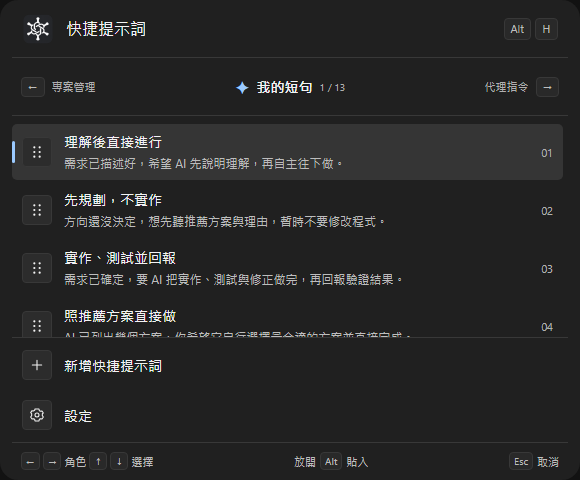
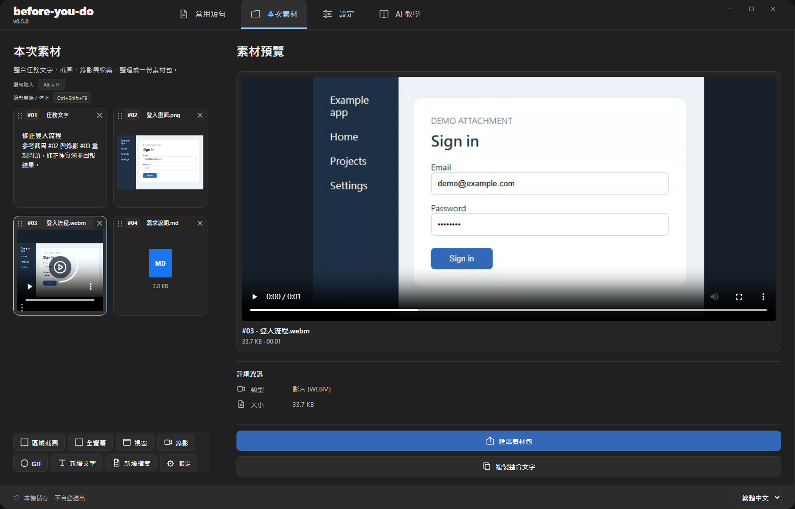

<h1 align="center">before-you-do</h1>

  <b>在 AI 動手之前，把該交代的補上。</b> 
  重複的要求，快速補一句；這次的圖片、文字與檔案，整理成一包。

  
  
  
  
  
  
  
  

繁體中文 · <a href="README.md">English</a>

每次都要重打「先規劃」「記得測試」，或來回貼上好幾張截圖？before-you-do 幫你減少重複輸入與整理資料的時間，更快把需求交代完整，再交給 AI。

## 1. 補一句：快速補強 AI 對話

把經常交代的要求存成短句，需要時隨手補上：

> 「先整理你理解的需求，再直接進行。」 
> 「只改必要的地方，不要順便重構。」 
> 「實際測試主要流程，完成後回報結果。」

1. 在 AI 對話框寫好需求，留下游標。
2. 按住 **Alt**，再按 **H**；用 **←／→** 切角色、**↑／↓** 選短句。
3. **放開 Alt 貼入**，檢查後自行送出。

短句、使用情境與排序都能自訂；快捷鍵也能調整。

## 2. 整理一包：把這次任務的內容放在一起

例如回報登入問題，需要兩張截圖、一段錄影和需求文字：

1. 開啟「**本次素材**」，加入文字、圖片與檔案；也能直接截圖或錄影。
2. 拖曳調整順序，依 **#01、#02…** 指出要 AI 參考的素材。
3. **匯出素材包**，把任務文字與附件一起交給 AI。

匯出內容包含 <code>prompt.md</code>、附件與 <code>manifest.json</code>。你也可以「複製整合文字」，取得文字與附件提示。

**目前需要自行附上匯出的檔案。** 尚未提供連續收集剪貼簿、或一次把全部圖片與檔案貼入 Agent 的功能。App 不會自動送出訊息。

## 下載與開始使用

**[下載最新版](https://github.com/jaylooloomi/before-you-do/releases/latest)** — Windows x64、Mac Apple Silicon、Mac Intel。

- **Windows：**解壓縮整個 ZIP，保留同資料夾內的 DLL，再開啟 <code>before-you-do.exe</code>；需要 WebView2 Runtime。
- **Mac：**提供建置檔，仍待實機驗證，尚未簽章／公證；截圖需 macOS 14+ 與螢幕擷取權限。錄影目前限 Windows。
- **升級：**先儲存各角色草稿，從系統匣完整退出舊版，再替換程式；保留原有資料夾。沒有自動更新。

資料存放在本機，不需要 API Key。你選擇把內容交給哪個 AI，並自行檢查、送出。

**v0.6.0：**新增[任務包切換](docs/task-packs.md)與[圖片標註／遮蔽](docs/image-editor.md)。升級前請備份素材；新的任務包格式不相容舊版。

## 常用操作

| 操作 | 快捷鍵 |
|---|---|
| 開啟選單、放開貼入 | 按住 Alt，再按 H；放開 Alt |
| 切換角色／選擇短句 | ←／→ 及 ↑／↓ |
| 取消選單 | Esc，或再按一次 H |
| 儲存目前角色短句 | Ctrl+S |

快捷鍵可在「設定」調整；Mac 使用 Option，儲存使用 Command+S。

[操作指南](docs/USER_GUIDE.zh-TW.md) 提供角色範本、截圖與錄影、快捷鍵設定、AI 修改短句、備份與開發說明。介面圖使用目前原始碼與示範資料；發布差異與平台限制也列於指南。

[MIT License](LICENSE) · [範本來源與授權](docs/USER_GUIDE.zh-TW.md#範本來源與授權)
