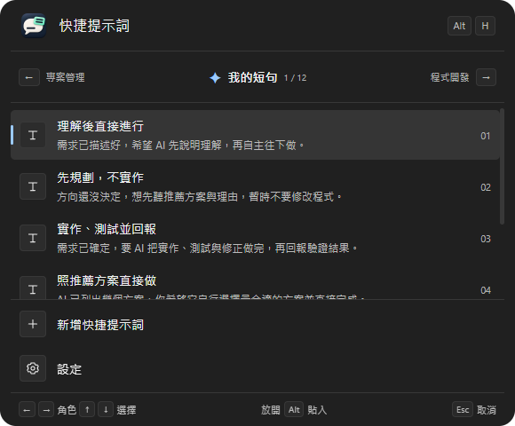
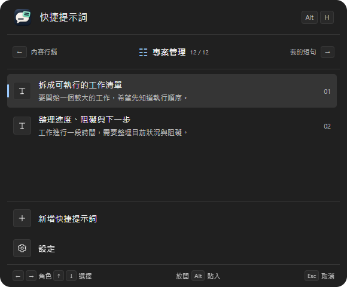
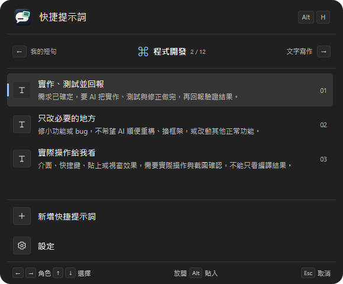
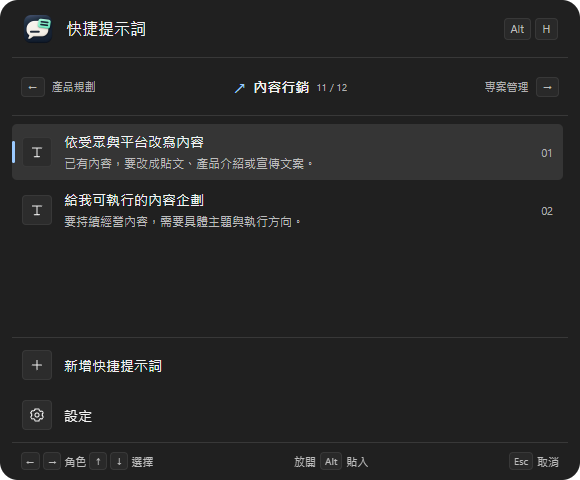
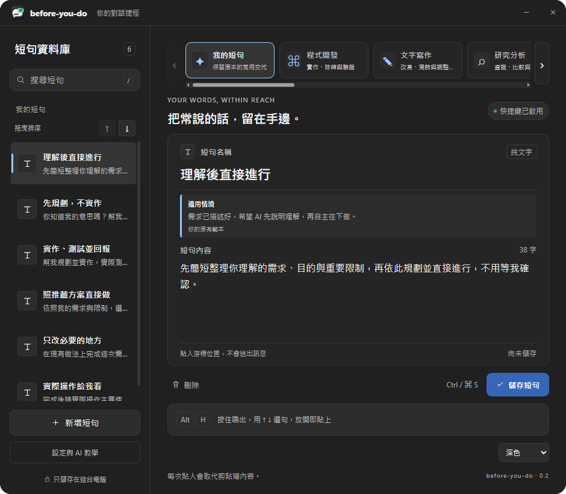

<p align="center"></p>

<h1 align="center">before-you-do</h1>

<p align="center">
  <b>在 AI 動手之前，把該交代的補上。</b><br>
  按住 <code>Alt + H</code>，選一句，放開貼入。你描述要做什麼，它幫你補上希望 AI 怎麼做。
</p>

<p align="center">
  受夠了每次都要重複提醒 AI，system prompt 也越寫越長？<br>
  把「記得測試」「只改指定範圍」「幫我潤飾文字」存成常用短句，<br>
  需要時快速補進對話，交代要求、規範與限制，不用每次重新打字。
</p>

<p align="center">
  
  
  
  
  
  
  <a href="https://github.com/jaylooloomi/before-you-do/actions/workflows/build.yml"></a>
  <a href="README.md"></a>
</p>

<p align="center">繁體中文 · <a href="README.md">English</a></p>

<p align="center">
  <a href="#使用情境">使用情境</a> ·
  <a href="#快速上手">快速上手</a> ·
  <a href="#安裝與啟動">安裝</a> ·
  <a href="#快捷鍵操作">快捷鍵</a> ·
  <a href="#常見問題">FAQ</a>
</p>

<p align="center"></p>

<p align="center"><sub>宣傳插畫：Alt+H 為預設快捷鍵，可在設定中調整。工具只貼入文字，不自動送出。</sub></p>

把常對 AI 重複交代的「先規劃」「只改必要部分」「做完要實際驗證」存成短句，在需求寫完後隨手補上。不需要 API Key、AI 帳號或 AutoHotkey，也不綁定特定模型。

**只貼入，不自動送出。** 你決定何時補充、選哪句，貼入後仍可修改。提示詞能表達要求，不保證 AI 一定遵守。

## 使用情境

「我的短句」提供六種常見的工作交代，「代理指令」另提供六筆啟動、接續對話與權限操作提示；另外還有開發、寫作、研究等角色專用短句，每句附使用情境。你可以直接用，也可以改成自己的口氣。

| 你現在遇到的情況 | 選這句 | 希望 AI 怎麼做 |
|---|---|---|
| 需求講得有點模糊，希望先知道它理解了什麼 | **理解後直接進行** | 簡短整理需求、目的與限制，再規劃並往下做 |
| 還在討論方向，暫時不想讓它改程式 | **先規劃，不實作** | 給出推薦方案與理由，先停在規劃階段 |
| 需求確定，希望它完成實作與驗證再回報 | **實作、測試並回報** | 實作、實測、修 bug、重測，說明結果與未驗證項目 |
| 它列了好幾個方案，你希望它自己判斷 | **照推薦方案直接做** | 選擇合適方案，說明理由後直接執行 |
| 只是修一個小問題，不想順便大改 | **只改必要的地方** | 保留正常功能，避免額外重構或擴大範圍 |
| 它說做完了，你希望確認真的能用 | **實際操作給我看** | 操作主要流程，涉及畫面的部分截圖並查看結果 |

例如，你這次只是想討論，可以補上：

> 你知道我的意思嗎？幫我規劃一下，直接給我你推薦的方案與理由，先不要實作。

方向確定、可以開始做時，則改選「實作、測試並回報」。**同一個需求，搭配不同交代，就能清楚表達這次要 AI 做到哪一步。**

也能新增自己的短句，例如「使用繁體中文，先說結論」或「先指出可能的取捨，再給建議」。它不綁定特定 AI，可用於接受一般文字貼上的網頁或桌面對話框；各應用程式的相容性仍以實際使用為準。

## 快速上手

以「幫我增加多語言」為例：

1. 在 AI 對話框寫下需求，先換行，把游標留在想補充文字的位置。
2. **按住 Alt，再按 H**，叫出你的常用交代。
3. 繼續按住 Alt，用 **←／→** 切到「我的短句」，再用 **↑／↓** 選擇「實作、測試並回報」。
4. **放開 Alt**，短句就會貼進原本的輸入框。
5. 看過內容後，再自行送出訊息。

```text
你先寫：
幫我增加多語言。

Alt + H → 選「實作、測試並回報」→ 放開 Alt

對話框裡變成：
幫我增加多語言。
幫我規劃並實作，實際測試主要使用流程；發現 bug 就修正並重測。
完成後告訴我測過什麼、結果如何，以及哪些還沒驗證，不用每一步等我確認。
```

<table>
<tr>
<td align="center" width="50%"><strong>我的短句</strong><br><br><sub>日常交代與實作驗證</sub></td>
<td align="center" width="50%"><strong>專案管理</strong><br><br><sub>拆解工作、追蹤進度與阻礙</sub></td>
</tr>
<tr>
<td align="center" width="50%"><strong>程式開發</strong><br><br><sub>實作、除錯與測試</sub></td>
<td align="center" width="50%"><strong>內容行銷</strong><br><br><sub>依受眾改寫、規劃選題</sub></td>
</tr>
</table>

選單不搶走原輸入框的焦點；角色列顯示目前角色、序號與前後角色。上圖展示「我的短句、專案管理、程式開發、內容行銷」四種角色，用 ←／→ 即可切換。底部「新增」與「設定」固定顯示；選到「設定」並放開組合鍵會回到短句管理主畫面。貼入後由你自行檢查與送出。

Windows 下，從 Alt+H 選「設定」或「新增」時，管理主視窗會出現在原本輸入視窗所在的螢幕，並配合該螢幕的可用工作區。一般從系統匣開啟的位置行為不變。

## 安裝與啟動

**最新功能版本：[v0.4.6](https://github.com/jaylooloomi/before-you-do/releases/tag/v0.4.6)。** 內建提示詞隨語系切換，自訂短句保留原文；另包含啟動恢復、emoji字數一致、JSON工具與外部改檔衝突保護。[版本說明](docs/releases/v0.4.6.md) · [發布流程](docs/RELEASING.md)。

### Windows

> v0.3.0 起包含角色切換與自訂使用情境。升級前請儲存編輯並完整結束舊版；既有短句檔案會保留。

到 [Releases 下載最新版](https://github.com/jaylooloomi/before-you-do/releases/latest) 的 **Windows x64 可攜版 ZIP**。另提供 macOS Apple Silicon 與 Intel 版本，但尚未經 Mac 實機驗證；目前發布檔皆未簽章。

原始碼倉庫不包含執行檔。可到 [GitHub Actions](https://github.com/jaylooloomi/before-you-do/actions) 查看建置結果及成功產生的檔案，或依下方步驟自行建置。

取得 Windows 版本後：

1. 解壓縮至同一個資料夾。若附有 `WebView2Loader.dll`，請與執行檔放在一起。
2. 確認電腦已安裝 Microsoft Edge WebView2 Runtime。
3. 完整結束舊版或占用 Alt+H 的 AHK，開啟新版。
4. 儲存短句，在 AI 對話框按 Alt+H 試用。

Windows 執行檔名稱為 `before-you-do.exe`。目前沒有自動更新功能。

到「**設定與 AI 教學 → 啟動設定 → 登入電腦後自動啟動**」可開啟登入啟動，預設關閉。登入時只啟動到系統匣，不會彈出主畫面；平常手動啟動仍會開啟主畫面。Windows 使用目前帳號的 Run 登錄項目，macOS 使用使用者的 LaunchAgent，不需系統管理員權限。移動可攜版位置後，請關閉再重新開啟此設定；刪除程式前請先關閉。作業系統的啟動設定或裝置政策仍可能停用啟動項目。

關閉管理視窗只會收起程式，Alt+H 仍可使用。要完全退出，請從系統匣圖示選單選「結束 before-you-do」。

### macOS 與其他平台

已有 macOS 原生 Option+H 與貼入處理、Apple Silicon／Intel 建置設定，**尚待實機驗證**，也未提供簽章與公證流程。使用時需允許輔助使用權限，必要時也需允許輸入監控。Windows exe 不能在 Mac 上使用。

Linux、手機、平板與瀏覽器擴充套件目前未提供。

## 快捷鍵操作

在**短句管理主畫面**，可用 **←／→ 切換角色、↑／↓ 選擇短句**，到頭尾會循環，並依目前搜尋結果選句。各角色會保留草稿與選取位置。編輯文字、操作下拉選單、查看設定／彈窗或等待儲存與角色載入時，方向鍵保留原本用途。在主畫面選句不會貼入或自動儲存。

焦點在管理視窗時，快捷鍵只收起視窗，不開選單、不貼入，未儲存草稿仍保留。回到外部輸入框後再按一次，才會選句貼入。從外部程式喚出時，會先收起管理視窗再開啟選單。

下表以預設 **Alt+H** 說明；可在「設定與 AI 教學 → 快捷鍵設定」改成自己的組合。更換後，選單提示同步更新，取消時改按你設定的按鍵。

| 按鍵 | 動作 |
|---|---|
| **按住 Alt，再按 H** | 在外部輸入框叫出選單，繼續按住 Alt |
| **←／→** | 瀏覽上一個／下一個角色，回到該角色第一句已儲存短句 |
| **↑／↓** | 選擇短句；到頂或到底會循環，包含底部的新增與設定列 |
| **放開 Alt** | 貼入選取的短句；選到新增列時開啟新草稿，選到設定列時開啟短句管理主畫面 |
| **選單開啟時，再按一次 H** | 關閉並取消，之後放開 Alt 也不貼入 |
| **Esc** | 關閉並取消 |
| **Ctrl + S** | 儲存目前角色清單中的全部有效短句；不會一次儲存其他角色的草稿 |
| **/** | 在管理畫面搜尋；正在編輯文字時不攔截 |

- 最常用的短句放第一句，**快速按下並放開 Alt+H 就能貼入第一句**。
- 選單使用鍵盤操作，不接受滑鼠點選，以保留原本的輸入位置。
- 長按 H 的自動連發不會誤關閉選單；第二次 H 需重新按下。
- macOS 對應 **Option ⌥ + H**、**Command + S**；目前仍待 Mac 實機驗證。

## 整理自己的工作交代

Alt+H 選單底部依序是「新增快捷提示詞」與「設定」。選到「設定」再放開組合鍵，會直接開啟短句管理主畫面，不貼入文字，也不新增草稿。「設定與 AI 教學」仍從左側按鈕進入。

按住組合鍵時，使用 **←／→** 瀏覽角色、**↑／↓** 選句；上方會顯示相鄰角色與目前序號。放開後才記住新角色，Esc 或再按一次觸發鍵取消時不改變原角色。管理畫面未儲存的草稿仍保留。

### 角色小卡與獨立短句

編輯區上方有 **13 個角色**，可用左右按鈕、滑鼠滾輪或觸控板橫向手勢瀏覽。原本短句保留在「我的短句」；其他角色各有自己的短句，可以獨立新增、編輯、刪除及排序。

| 角色 | 什麼時候適合用 | 預設短句數 |
|---|---|---|
| 我的短句 | 通用工作交代：先理解、先規劃或完成後回報 | 6 |
| 代理指令 | Claude Code、Codex、Antigravity 與 OpenCode 指令及快捷鍵提示 | 12 |
| 程式開發 | 實作功能、限制修改範圍、確認真的能用 | 3 |
| 文字寫作 | 潤飾初稿、調整語氣、取得可直接使用的版本 | 3 |
| 研究分析 | 查證資訊、比較方案、找出觀點盲點 | 3 |
| UI 設計 | 統一視覺規則、檢查畫面狀態與不同尺寸 | 2 |
| 前端開發 | 實作互動介面、量測載入或操作延遲 | 2 |
| 後端架構 | 定義 API 與資料契約、檢查失敗與復原路徑 | 2 |
| 程式碼審查 | 審查實質問題、檢查相鄰流程是否退步 | 2 |
| 測試驗證 | 實際驗收、重現 bug、修正與回歸測試 | 2 |
| 產品規劃 | 把想法整理成需求、排定功能優先順序 | 2 |
| 內容行銷 | 依受眾改寫內容、規劃可執行的選題 | 2 |
| 專案管理 | 拆解工作、整理相依關係、進度與阻礙 | 2 |

「我的短句」與「程式開發」之間的「代理指令」角色包含 Claude Code、Codex、Antigravity 與 OpenCode 的指令及快捷鍵提示。OpenCode 範例包含 `opencode --auto`、`/sessions` 與切換 Build／Plan 模式的 `[Tab]`。App 只會貼入文字，不會執行指令。升級不會重設或自動擴充既有清單，需要時可從範本庫加入。

表中的數量是新角色的預設值；升級不會重設你已修改的內容。這些角色是短句分類，不會在 App 內呼叫 AI 或自動執行任務。

<p align="center"></p>

Alt+H 使用目前角色**已儲存**的短句。切換時，各角色未儲存的編輯與選取位置會留在目前程式中；重新啟動也會記住上次角色，但結束前仍需儲存編輯。匯入、重新載入及 AI 修改指令只針對目前角色。

「我的短句」沿用 `snippets.json`；其餘角色使用同資料夾的 `snippets-<角色 ID>.json`，例如 `snippets-developer.json`、`snippets-designer.json`、`snippets-product.json`。各檔案的上一版備份為對應的 `.json.bak`，目前角色另存於 `roles.json`。設定頁會顯示目前角色的實際檔案路徑。

### 填寫使用情境

新增或編輯短句時，可在名稱下方的「適用情境（選填）」說明何時使用，最多 1,000 字。Alt+H 會將它顯示為選句提示，實際貼入仍只有短句內容；編輯後請按儲存。JSON 匯入與 AI 修改指令也支援在 `name`、`text` 之外加入選填的 `scenario`。舊檔仍可直接使用；未自訂時沿用內建範本提示，清空自訂情境則移除該提示。

例如，情境寫「實作完成後，需要驗證主要流程時使用」，與實際指令分開保存：

```json
[
  {
    "name": "測試並回報",
    "scenario": "實作完成後，需要驗證主要流程時使用。",
    "text": "實際測試主要使用流程，發現 bug 就修正並重測。回報測試項目、結果，以及哪些部分尚未驗證。"
  }
]
```

### 自訂快捷鍵

預設 **Alt+H**。到「設定與 AI 教學 → 快捷鍵設定」，選擇 Alt／Option 或 Ctrl，可加上 Shift，再搭配 A–Z、0–9 或空白鍵，按「儲存快捷鍵」立即生效，下次啟動也會沿用。也能一鍵恢復 Alt+H。

例如改成 **Ctrl+Shift+J**：按住 Ctrl+Shift，再按 J 喚出；用 ↑／↓ 選句，放開組合鍵貼入。選單開啟時再按一次 J 可取消。Windows 若發現新組合已被占用，會保留原快捷鍵與設定；macOS 請自行避開其他 App 的組合。常見的 Ctrl 複製、貼上、儲存等編輯組合不開放指定。

### 選擇介面主題

管理畫面底部可選「跟隨系統」、「亮色」或「暗色」。新安裝預設跟隨作業系統；升級時會保留已儲存的主題選擇。跟隨系統時，作業系統切換亮色或暗色外觀，App 也會同步更新。

### 新增、編輯與排序

在管理畫面按「新增短句」，填入名稱與內容，再按「儲存短句」。也可以從 Alt+H 選單底部選「新增快捷提示詞」，放開 Alt 直接建立草稿。

左側可以搜尋、拖曳排序，或用 ↑／↓ 按鈕調整位置。**儲存後，下一次 Alt+H 就會使用新的內容與排序。** 尚未儲存的編輯不會改變快捷選單。

每個角色的清單可保留 1～100 句；名稱最多 100 字，內容最多 20,000 字。

**儲存只處理目前角色。** v0.3.1 起，完整短句可以先儲存，不會被其他未完成草稿擋住。未完成草稿留在編輯器，待完成清單會指出短句名稱與問題欄位；點擊即可選取該筆並跳到待補欄位。若是已儲存短句被改成不完整，檔案與快捷選單會保留它上次已儲存的版本；新的未完成草稿則尚未加入快捷選單。如果沒有完整短句或可保留的已存版本，不會寫入檔案。

**每個角色分別標示未儲存狀態。** 角色卡片會顯示標記，總覽也會列出其他仍有修改的角色；儲存一個角色不代表其他角色也已儲存。正常退出程式前，確認視窗會列出所有未儲存角色；可以取消並回去儲存，或明確選擇放棄修改後退出。關閉管理視窗仍只是收起，程式會繼續執行。

未完成草稿保留在目前程式的記憶體中；明確放棄退出、強制終止或系統故障後，不會自動復原草稿。

### 四語介面與範本

在「設定與 AI 教學」選擇 **繁體中文、简体中文、English、日本語**，或跟隨系統。切換後立即更新主畫面與快捷選單，並記住你的選擇；不支援的系統語言使用英文。

**未修改的內建短句會隨介面語言切換**，包含名稱、正文與快捷選單實際貼入的內容；切換語言不會改寫已儲存的 JSON。新增、匯入或自訂過的短句，以及未儲存草稿，都保留原文。舊資料只有名稱與正文完全符合原始範本、且沒有自訂情境時才視為內建。範本庫另有四語版本，「新增此範本」只加入個人草稿，不會取代既有清單。

### 用自己的 AI 幫忙改短句

「設定與 AI 教學」提供兩種方式，不需要在 App 串接 AI：

- **一般聊天 AI：**複製教學指令與已儲存短句，請 AI 依需求修改，再把完整 JSON 貼回設定頁。程式檢查格式，經你確認後套用並備份原檔。
- **能存取本機檔案的 AI：**複製含實際檔案路徑的修改指令，讓 AI 備份並修改檔案。完成後回 App 按「重新載入檔案」，避免用舊編輯內容覆蓋新檔。

匯入與重新載入會取代目前角色的清單和未儲存草稿，請先保留需要的編輯。一般網頁聊天無法只憑路徑讀寫你的本機檔案。

## 為什麼做這個工具

每次開新對話，真正重複的常常是工作方式：「先整理理解」「先規劃，不實作」「做完請回報測過什麼」。重打費時，切去筆記找文字又會打斷思路。

before-you-do 把這些交代留在手邊。需求每次不同，你習慣的工作方式可以重複使用；不必綁定單一模型，也不用在每個網站各裝擴充套件。

名字就像家人在你出門前叫住你：「等一下，還有一件事要交代。」

## 運作方式

```text
先寫這次的需求
      ↓
按住 Alt + H → ← → 切角色 → ↑ ↓ 選擇工作交代
      ↓
放開 Alt → 貼入原本的輸入位置
      ↓
看過內容，再自行送出
```

App 記住原目標，顯示不搶焦點的選單；放開 Alt 後，透過系統剪貼簿與貼上操作補入文字。若目標已切換，會取消貼入。選到新增列則開啟草稿，選到設定列則開啟短句管理主畫面，兩者都不貼入文字。

這是本機文字工具：不讀取 AI 對話來判斷該用哪句，也不向模型發送請求。

## 相容性與目前限制

| 環境 | 狀態 |
|---|---|
| Windows | 已實機驗證選句、貼入、取消與新增流程 |
| macOS（Apple Silicon／Intel） | 已有原生程式碼與 CI 建置設定；待實機驗證 |
| Linux、手機、平板 | 尚未支援 |
| AI 網頁與桌面對話框 | 接受一般文字貼上時可使用；未逐一驗證所有應用程式 |

快捷鍵預設 Alt+H／Option+H，可在設定頁調整。目前沒有雲端同步、富文字或自動更新功能。

## 資料存在哪裡？

短句保存在本機 JSON，App 沒有內建雲端同步，也不會自行把短句傳給 AI。要交給哪個 AI，由你自行選擇與貼入；文字進入聊天服務後，適用該服務的資料處理方式。

| 平台 | 短句檔案 |
|---|---|
| Windows | `%APPDATA%\dev.quicksay.desktop\snippets.json` |
| macOS | `~/Library/Application Support/dev.quicksay.desktop/snippets.json` |

快捷鍵另外保存在同一個資料夾的 `shortcut.json`，不會改寫短句檔。也可在「設定與 AI 教學」查看實際路徑、開啟資料夾。每個角色儲存時，對應的 `.json.bak` 保留上一版；它不是完整歷史紀錄。手動還原前請先結束 App，另外保留目前檔案，再將該角色的備份複製回設定頁顯示的原始檔名。

舊名為 QuickSay，因此沿用 `dev.quicksay.desktop` 識別碼、資料路徑與偏好設定，避免更名後遺失原有資料。舊 WPF XML 的相容讀取位置仍是 `%APPDATA%\QuickSay\settings.xml`。

**每次貼入會覆寫系統剪貼簿，目前不會自動還原。** 短句檔與剪貼簿不加密；使用剪貼簿歷史或同步工具時，請一併考慮它們的紀錄方式。

## 常見問題

**需要 AI 訂閱、API Key 或 AutoHotkey 嗎？**

不需要。這個工具只負責保存並貼入你準備好的文字，不呼叫 AI 模型，也不依賴 AHK。

**它會自動替所有對話加上提醒嗎？**

不會。你決定什麼時候叫出選單、選哪句，以及何時送出。貼入之後仍可自行修改。

**Alt+H 沒反應怎麼辦？**

檢查主畫面的快捷鍵狀態，確認舊版或其他程式沒有占用 Alt+H，再按「重新啟用快捷鍵」。Mac 另需檢查輔助使用與輸入監控權限。若目前組合被其他程式占用，可到設定頁更換。

**在管理畫面按 Alt+H，為什麼只收起視窗？**

這是防止把短句貼回程式自己輸入框的設計，草稿仍保留。先回到外部對話框，再按一次快捷鍵選句。

**在選單切了角色，按 Esc 後為什麼回到原角色？**

←／→ 是暫時瀏覽；只有放開組合鍵完成貼入、選新增或設定時，才記住新角色。Esc 或第二次觸發鍵會取消整次操作。

**為什麼沒有貼入？**

先確認游標位於可接受貼上的輸入框，而且 Alt 與 H 都已放開。若切換了原目標，程式會取消貼入；Windows 目標程式以系統管理員權限執行時，也可能拒絕一般權限 App 的貼入操作。

**新增了短句，為什麼選單看不到？**

新增的是草稿。填好名稱與內容並儲存後，才會出現在下一次 Alt+H 選單。

## 開發與建置

以 Tauri 2、Rust、HTML／CSS／JavaScript 實作。正式版將前端資源內嵌於桌面程式。

前置需求：Node.js 22.12+ 或 24+、Rust stable；Windows 需 MSVC C++ Build Tools、Windows SDK 與 WebView2，macOS 需 Xcode Command Line Tools。詳細環境請見 [Tauri 前置需求](https://v2.tauri.app/start/prerequisites/)。

```sh
git clone https://github.com/jaylooloomi/before-you-do.git
cd before-you-do
npm ci
npm run dev
```

測試與正式建置：

```sh
npm test
npm run build:ui
cargo test --manifest-path src-tauri/Cargo.toml --locked
npm run build
```

Windows 執行檔位於 `src-tauri/target/release/before-you-do.exe`；macOS App 位於 `src-tauri/target/release/bundle/macos/before-you-do.app`。也可用 `npm run build -- --no-bundle` 僅建置執行檔，或在 Mac 使用 `--bundles app`。

<details>
<summary><b>原始碼導覽與桌面整合測試</b></summary>

| 路徑 | 內容 |
|---|---|
| `src/main.js`、`src/style.css` | 管理介面與快捷選單 |
| `src/templates.json`、`src/template-locales.js` | 內建範本、使用情境與四語版本 |
| `src/locales.js`、`src/i18n.js` | 介面翻譯與語言切換 |
| `src/settings.js`、`src/ai-prompts.js` | 設定、AI 教學與匯入流程 |
| `src/roles.js`、`src/extra-role-presets.js` | 13 個角色與四語專用短句 |
| `src/role-defaults.json`、`scripts/generate-role-defaults.mjs` | 建置時產生供原生選單使用的預設短句 |
| `src-tauri/icons/`、`scripts/icons.py` | 新版白色交織圖示及各平台輸出 |
| `src-tauri/src/` | 原生快捷鍵、貼入、儲存與視窗處理 |
| `tests/`、`scripts/` | 測試程式與建置工具 |

圖示採用你提供的深灰圓角底與白色交織符號，已套用到桌面程式、系統匣及標題列。[圖示原稿與設計說明](docs/branding/app-icon.md)。

GitHub Actions 包含 Windows 與兩種 Mac 建置工作。建置成功不代表已驗證所有平台的實際快捷鍵、焦點與貼入行為。Windows 桌面整合測試可使用 `scripts/test-windows.ps1`；它會操作系統按鍵與剪貼簿，請在獨立測試時段執行。

</details>

## 範本來源與授權

研究分析之後新增的 8 個專業角色，各提供 2 句參考 [agency-agents-zh](https://github.com/jnMetaCode/agency-agents-zh) 改寫的短句，附使用情境與來源。這些是適合補進對話的簡短指令，不是完整搬入原專案的系統提示詞，也未串接多代理執行功能。原專案的 [MIT 授權與作者聲明](docs/third-party/agency-agents-zh-LICENSE.txt) 已保留。

「照推薦方案直接做」「只改必要的地方」參考 [Get Shit Done 執行流程](https://github.com/gsd-build/get-shit-done/blob/main/get-shit-done/workflows/execute-plan.md)；「實際操作給我看」參考 [Superpowers 驗證原則](https://github.com/obra/superpowers/blob/main/skills/verification-before-completion/SKILL.md)。均經改寫並提供其他語言版本，不是原作者原文。

本專案採用 [MIT 授權](LICENSE)。Copyright © 2026 Arthur Wang。第三方素材仍適用各自的授權與作者聲明。

「代理指令」另含 Claude Code 的 [Shift+Tab] 按鍵提示與 Codex 的 /permissions。按鍵提示只貼入文字，不會模擬按鍵。
