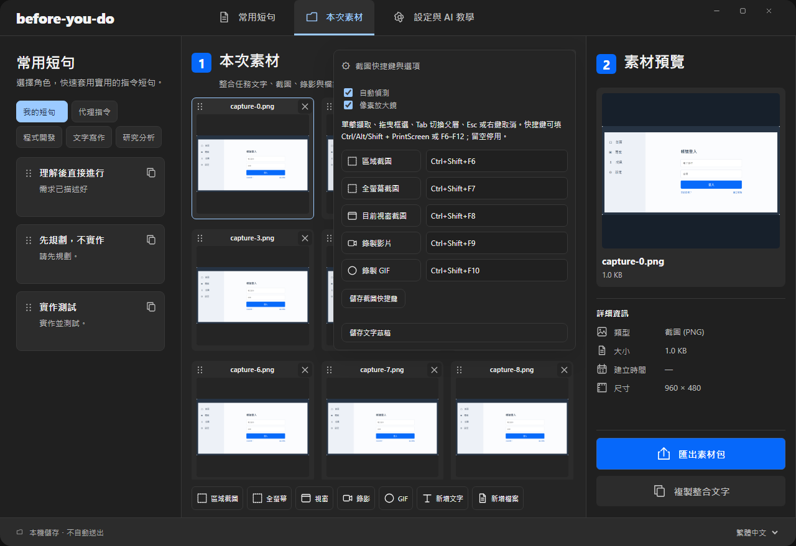
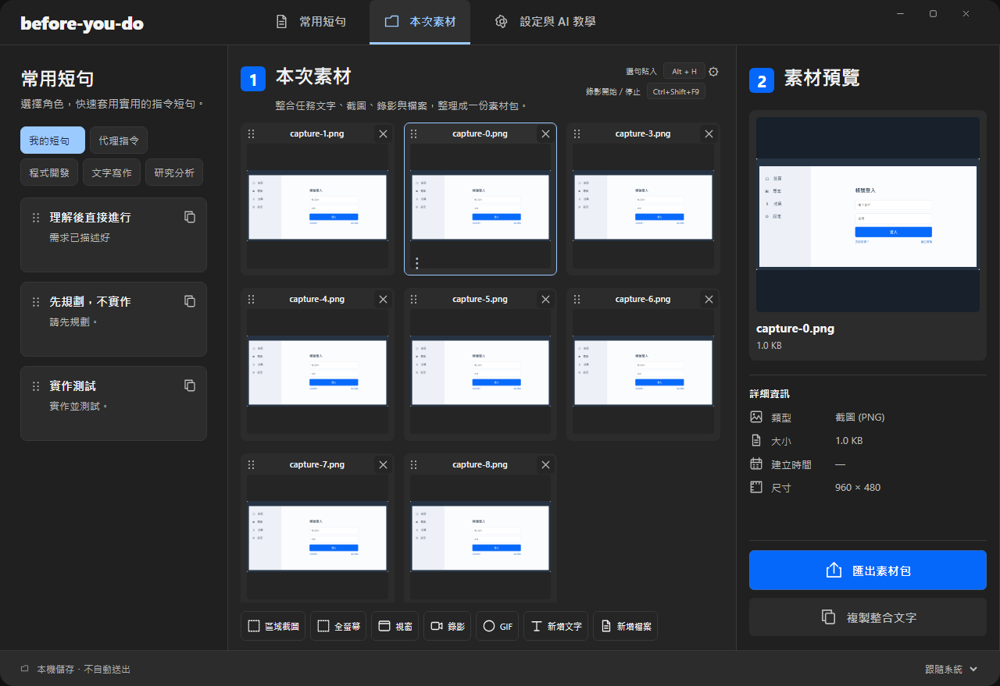
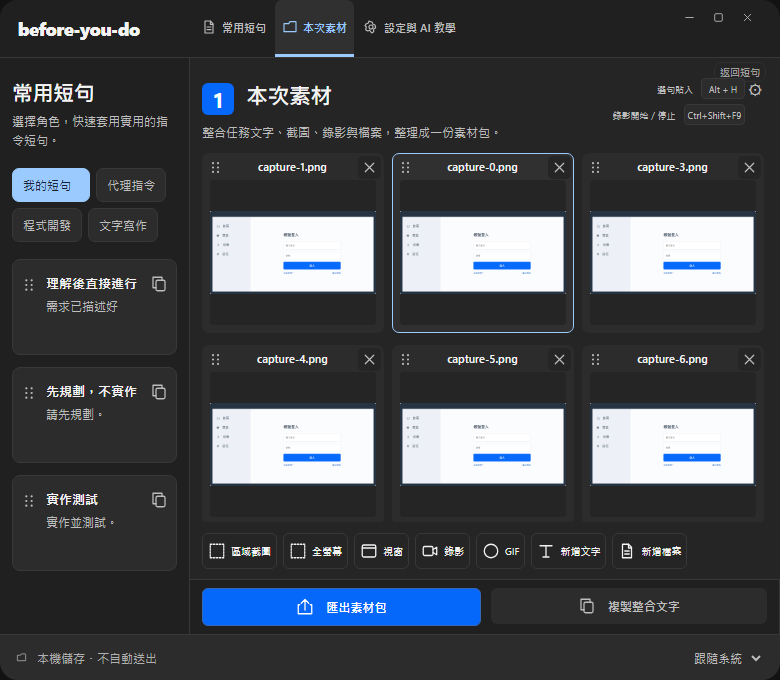

# 縮圖網格與快捷鍵配對列驗證結果

日期：2026-10-31；分支：`codex/swiss-workspace-layout`；計畫：`docs/plans/GALLERY_PAIRED_SHORTCUTS.md`。

## 完成內容

1. 「截圖快捷鍵與選項」展開後，五個功能各有一列實際執行按鈕＋對應快捷鍵輸入。配對列使用原動作的權限、busy、錄影狀態，不新增第二組全域快捷鍵。
2. 中央素材改為 ShareX 式網格：檔名在上、媒體縮圖在下，右上角小 × 移除；文字與一般檔案也使用一致卡片。自適應欄數，原始圖像比例保留。
3. 新增真正的 HTML drag-and-drop 素材排序把手，使用既有 `materials_order` 持久化；上下移選單保留供鍵盤使用。排序保留目前選取 ID，原文與檔案不改寫。
4. 影片卡提供播放入口，選取右側實際播放器；清單原生播放／暫停／seek／音量保留。內嵌影片播放時隱藏大播放遮罩，暫停後恢復。
5. 修正新播放入口可能在 src 尚未就緒時呼叫 play 的問題：等待來源準備，並檢查播放器仍連接且仍選取該素材，避免過期播放。
6. 四語、深淺主題、窄視窗仍可使用；長語系按鈕以省略號與完整 tooltip 避免遮住快捷鍵欄。
7. 原音效維持，A/B 本機比較與數據另見 `STOP_SOUND_COMPARISON.md`。

## 執行結果

| 驗證 | 結果 |
| --- | --- |
| JS unit | 55 passed |
| Component | 15 passed，輸入 focus／autosave／失敗復原正常 |
| Rust | 52 unit + 16 integration passed；1 個既有註冊全域快捷鍵測試 ignored |
| 完整 E2E | 最終 73 passed，0 skipped／unexpected／flaky；`artifacts/qa/gallery-complete/e2e-results.json` |
| 補充測試 | 初步相關 15 passed；四語／深色／配對列與拖曳／實際影片操作 3 passed；最終完整套件包含上述新案例 |
| 正式 build | `npm run build -- --no-bundle` 成功，既有 dead_code warnings 保留 |
| 原生影片 | 真正 WebM 解碼、播放時間前進、暫停／seek／音量、metadata／檔案不變；0 runtime error |
| 原生 IPC | 隔離持久化與實際匯出、拒絕無效模式與過期 session；0 runtime error |
| A/B 音效 | 兩個原檔與串接檔均實際解碼與靜音播放通過；0 桌面音效播放 |

每個 E2E 都監聽 pageerror／console.error。新測試使用 role／label／文字定位，沒有硬編碼 sleep。截圖停用有限 CSS 動畫以避免截到主題切換中間狀態，不改 App 的動畫行為。

原生證據：`artifacts/native-gallery-final-video/result.json`、`artifacts/native-gallery-final-ipc/result.json`。原生測試為獨立 profile／preview 資料、0 可見視窗、0 桌面輸入與 0 系統剪貼簿存取。未作 macOS 實機或實體拖曳鍵鼠測試；drag-and-drop 已在 headless Chromium 實際操作驗證。

正式執行檔：`src-tauri/target/release/before-you-do.exe`。
SHA256：`E7F45F1A033E2CD5E4C4B7627C535D73000073574D611A9DE5D7D8216F02C988`。

## 資料與執行狀態

原本的短句、設定與所有草稿不遷移、不覆寫；使用中的原 App PID 80832 未關閉／替換。全部變更在本分支；測試只操作隔離素材。未使用 Computer Use、未修改 ShareX 設定、未把 ShareX 音效放入 App、未合併 main 或公開 Release。

以下是實際 UI 的測試素材截圖：

