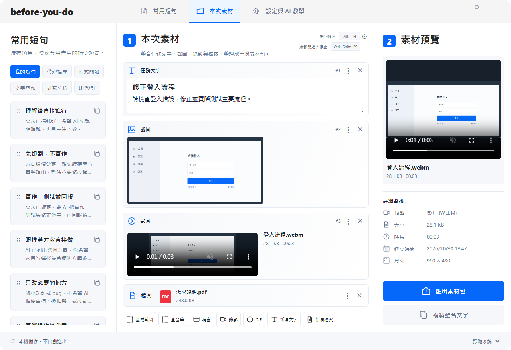
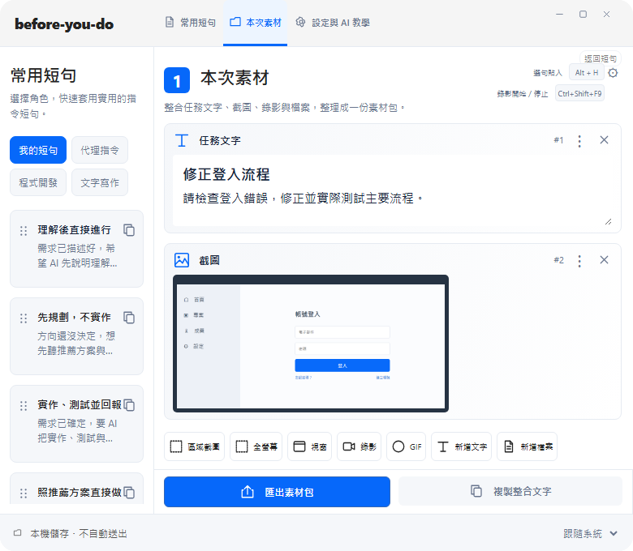
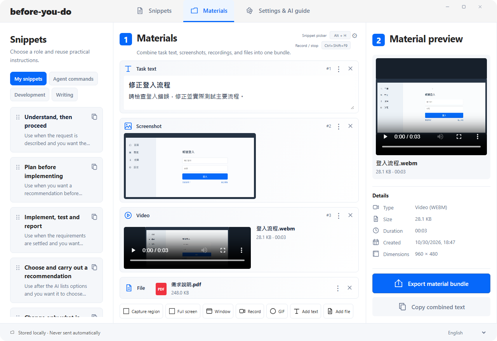

# 參考圖還原與功能驗證結果

日期：2026-10-30。分支：`codex/swiss-workspace-layout`；基準：`16c5165`。

## 逐區比對

以使用者提供的 1280×879 圖片為參考，實際渲染同尺寸 UI。不是把概念圖當背景，也沒有以靜態圖取代操作。

| 區域 | 上一版差異 | 本輪結果 |
| --- | --- | --- |
| 頂部 | 品牌過小、入口沒有圖示 | 純文字品牌、文件／資料夾／設定圖示、藍色底線；新增最大化／還原入口 |
| 欄寬 | 240／755／285 | 292／650／338，含欄內 padding／邊線；寬度隨 viewport 調整 |
| 左側 | 搜尋與排序占空間、短句字太小 | 素材模式保留標題、說明、角色與拖曳卡；搜尋／排序與新增在常用短句頁仍可使用；名稱與情境字級提高 |
| 中央標題 | 本次 prompt 素材、沒有鍵位提示 | 顯示「本次素材」、整合說明與即時快捷鍵；ARIA 名稱保留完整語意 |
| 素材卡 | 長文字操作按鈕、卡片種類不明 | 四種圖示、編號、收合選單、移除；影片縮圖搭配檔名／大小／時長，檔案小卡有格式識別 |
| 工具列 | 多排控制與說明壓縮內容 | 常態一排七項：區域／全螢幕／視窗／錄影／GIF／文字／檔案；權限、安裝、進行中或錯誤仍會顯示必要控制 |
| 右側 | 缺少完整資訊列 | 真實預覽、類型／大小／時長／建立時間／尺寸，固定藍色匯出與次要複製按鈕 |
| 底部 | 敘述與位置不一致 | 本機儲存、不自動送出與語言切換；四語、深色仍保留 |

## 不偽造的差異與界線

- **不是逐像素相同**：參考圖是示意圖片，實作使用平台字體及真正的 HTML video 原生控制列；進度條、播放圖示與字形會有平台差異。
- 保留既有 13 個角色與原本順序、使用者短句／情境，不改成示意圖中的 5 個角色或 3 句內容。角色可以捲動選取。
- 素材內容、檔名、時間、尺寸與時長使用實際資料。影片保持原始比例，可能出現黑邊；不拉伸成示意圖比例。未知資訊顯示「—」。
- 「建立時間」是素材存入本機素材區的檔案建立時間，並非宣稱原始拍攝日期；tooltip 有明確說明。舊素材不遷移或覆寫。
- 780 寬時收起獨立 inspector，清單仍有預覽／播放；匯出與複製保留在底部。390 寬不屬原生 App 支援範圍。

## 修正的缺陷

1. 素材頁 Ctrl+S 原本只攔截瀏覽器行為、沒有儲存：現在真正 flush 素材草稿；失敗仍保留原文。
2. 選取或排序造成播放器節點移除時，沒有明確清理播放：切換 inspector 前暫停舊播放器，重建清單前暫停全部媒體。
3. 刪除素材後仍持有其 base64 Promise：渲染時清理不存在素材的預覽快取。
4. 刪除選取素材後總是跳第一筆：現在使用相鄰有效項目 fallback；排序仍以素材 ID 保留選取。
5. 非同步 metadata 可能在改選後返回：只有對應資訊表仍連接 DOM 才更新，過期結果不覆蓋新預覽。
6. 詳細資訊缺漏：新增唯讀 `materials_info` IPC，先驗證主視窗與 bundle 中已知非文字 ID，再讀取受控檔案 metadata；未知 ID／路徑跳脫請求拒絕，不修改 session.json。
7. 設定過的快捷鍵沒有出現在工作台：標題提示依目前 Alt+H 設定與實際錄影綁定更新，儲存或外部變更後同步。

## 測試與證據

| 層級 | 結果 |
| --- | --- |
| JS unit | 55 passed，0 skipped；`artifacts/reference-unit.log` |
| Component | 15 passed；素材輸入 focus、autosave／復原及錯誤仍正常；此層 statement coverage 31.58%，不宣稱完整產品 100% coverage |
| Rust | 52 unit + 16 integration passed；另有 1 個既有全域快捷鍵註冊測試預設 ignored；本輪新增實際檔案 metadata／唯讀／拒絕未知 ID 測試 |
| 完整 E2E 第一輪 | 70 passed，0 skipped／unexpected／flaky；`artifacts/qa/reference-run1/e2e-results.json` |
| 完整 E2E 第二輪 | 70 passed，0 skipped／unexpected／flaky；`artifacts/qa/reference-run2/e2e-results.json` |
| 原生 WebView | VP8/Opus 真正解碼、播放時間前進、暫停、seek、音量、無 autoplay、檔案 metadata／實際大小／建立時間、原素材不變；0 runtime error |
| 原生 IPC | 無效 capture 模式、過期 session、隔離持久化、實際匯出均通過；0 runtime error |
| 原生錄影／GIF | VP8 與 GIF 實際編碼解碼、暫停續錄、匯出、取消不新增素材、崩潰清理編碼器、測試快捷鍵註冊與衝突 rollback 均通過；0 runtime error |
| 正式 build | `npm run build -- --no-bundle` 成功；既有 dead_code warnings 保留 |

原生證據：`artifacts/native-reference-final-video/result.json`、`artifacts/native-reference-final-ipc/result.json`、`artifacts/native-recording-1793357008511/result.json`。錄影 audit 未啟用 UI／聲音播放，不宣稱本輪有人工聽驗。最大化入口以 E2E 驗證命令並檢查既有原生實作，未操作使用中的桌面視窗。未進行 macOS 實機測試。

每個 E2E 均監聽 console.error／pageerror，任何未捕獲錯誤會失敗。沒有新增 skip 或硬編碼 sleep；定位使用 role、label、文字。

## 視覺證據與重現

`node scripts/capture-reference-layout.mjs` 會自行啟動隔離 Vite 與 headless browser、使用明確的測試素材渲染，結束後關閉；不連線使用中的 App、不存取系統剪貼簿、不注入桌面輸入。登入頁 PNG 與真正的 WebM 是測試 fixtures，PDF 與 timestamp 示範欄位屬 browser boundary fixture，並非使用者資料。原生 metadata 已以另外的實際檔案測試驗證。

已檢視 1280、780、英文與原生 WebView 截圖；另外保存 1920、940。圖片來自實作渲染，非生成示意圖。

## 保護原有資料

未關閉／替換使用中的正式 App，未透過其 IPC 儲存資料或改設定。原程序 PID 80832 維持運作；測試僅使用隔離 bridge、獨立 preview 資料及 WebView profile。原短句、設定與記憶體草稿保留。未使用 Computer Use；未合併 main、未公開 Release。

正式執行檔：`src-tauri/target/release/before-you-do.exe`；SHA256：`124336086DCC23C1002F1AFD1780011599857124B5E3A67945C6DDE9779E3EC4`。
