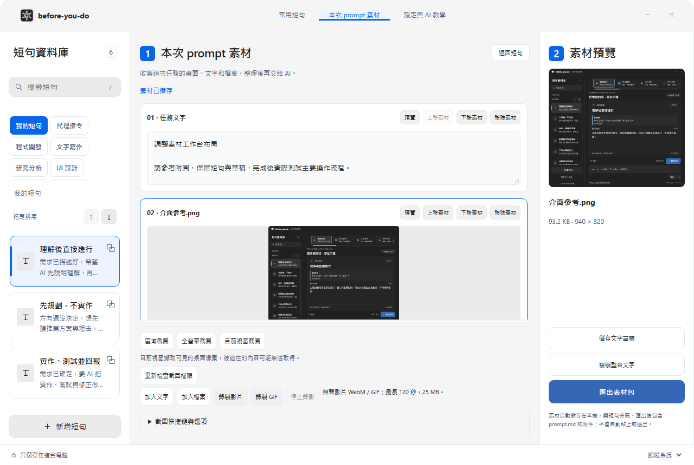
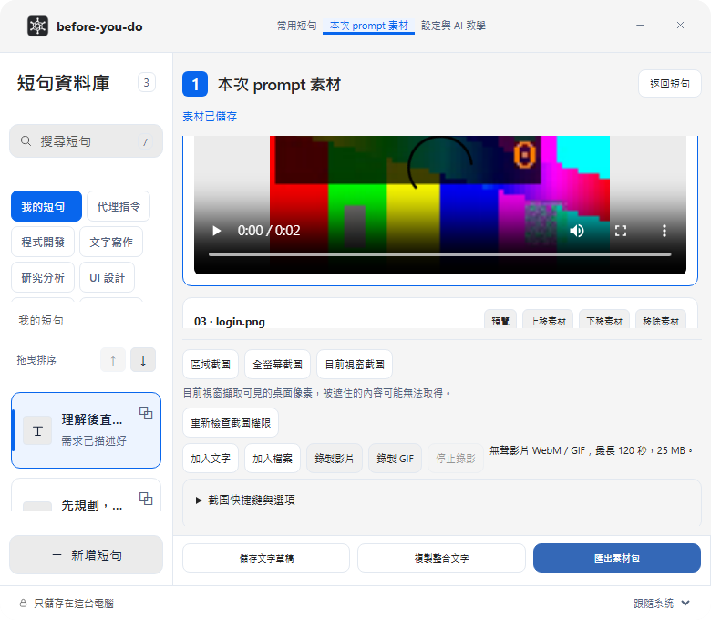
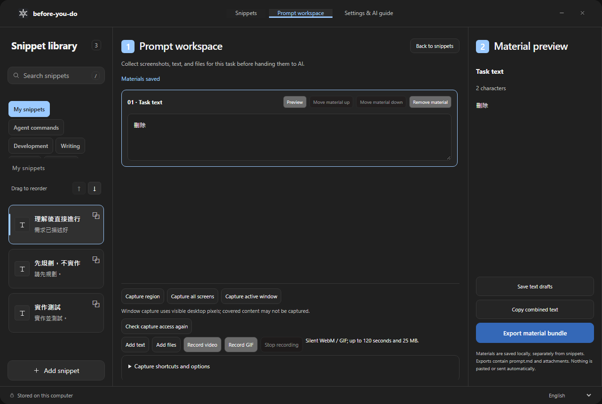
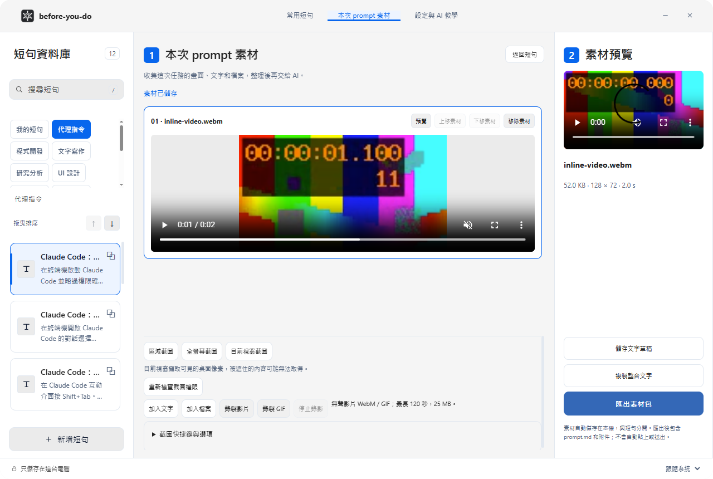

# 三欄素材工作台驗證紀錄

日期：2026-10-30。分支：`codex/swiss-workspace-layout`。計畫：`docs/plans/SWISS_WORKSPACE_LAYOUT.md`。

## 完成的布局與行為

- 頂部三個入口：常用短句、本次 prompt 素材、設定與 AI 教學；目前頁面有選取狀態。
- 左側角色改為小按鈕，可捲動選擇完整角色清單。短句卡顯示情境，保留搜尋、排序、編輯與獨立複製。
- 素材頁中央清單與右側預覽。以素材 ID 保留選取，排序不會誤選另一個素材，刪除後選取有效項目。
- 預覽文字、圖片、影片與檔案資訊；顯示實際檔案大小、解碼尺寸和影片時長，不捏造建立時間。未知格式仍可匯出。
- 中央與右側影片都有原生控制列，不自動播放；開始另一個播放器會暫停原播放器，離開素材頁也會暫停。
- 擷取／新增工具列與匯出操作固定於清單外。780 寬視窗收起獨立預覽，保留清單內預覽及播放，匯出按鈕改為橫排。
- 底部語言選單支援四語。用戶文字與檔案名稱不經翻譯處理；保留原有淺／深／系統主題選擇。
- 預設視窗 1280×860，依目前螢幕工作區縮小；原有 780×680 最小尺寸保留。
- 短句資料格式、角色儲存契約、素材 IPC、截圖與錄影快捷鍵、Alt+H 操作方式沒有變更。

## 實際執行

| 驗證 | 結果／證據 |
| --- | --- |
| `npm test` | 54 項通過；涵蓋字數、角色、翻譯、儲存與幾何邏輯 |
| `npm run test:components` | 15 項通過；含素材 autosave／失敗處理；component 層整體 statement coverage 30.23%，不代表全產品總覆蓋率 |
| `cargo test --manifest-path src-tauri/Cargo.toml` | 51 unit + 16 integration 通過；另有 1 個既有全域快捷鍵註冊測試預設忽略，避免干擾使用中的快捷鍵 |
| 完整 Playwright 固定版本回歸 | 兩輪各 68 項全部通過；0 skipped、0 retries；每個 E2E 案例均監聽 console.error 與 pageerror |
| `npm run build -- --no-bundle` | 正式 Windows release executable 編譯成功；保留既有 dead_code 警告 |
| 原生影片驗證 | WebView 真實 VP8/Opus 解碼、播放時間前進、暫停、seek、音量、禁止 autoplay 均通過；0 runtime error |
| 原生 IPC 驗證 | 無效模式與過期 session 拒絕、隔離持久化、匯出檔案驗證均通過；0 runtime error |
| 視覺檢查 | 已檢視 1280、780 以及正式 Windows WebView 的實際渲染截圖；另產生 940、1920、四語與深色畫面 |

原生證據：`artifacts/native-swiss-final-video/result.json`、`artifacts/native-swiss-final-ipc/`。上述原生測試使用獨立測試資料與 WebView profile，0 可見視窗、0 桌面輸入、0 系統剪貼簿存取。

## 測試中修正的問題

1. 舊角色列三欄 grid 殘留，令移至側欄的角色卡被裁切：改為完整寬度的可捲動按鈕列。
2. 縮小角色卡後說明不可見，導致讀屏名稱丟失：角色保留完整 accessible name 與 tooltip。
3. 新增複製按鈕造成短句定位名稱重複：複製使用獨立編號名稱，短句選取保留名稱與正文。
4. 步驟編號 CSS pseudo text 被算入標題名稱：改用 aria-hidden 裝飾標籤。
5. 窄視窗新增操作被工具列擠出：調整控制項優先順序，匯出按鈕不換行堆疊。
6. Inspector 的使用者文字可能被全域翻譯綁定處理：加入受保護內容區，測試直接使用翻譯 key 作為任務內容確認仍保留原文。

## 資料保護與界線

未關閉或替換目前執行的正式 App（PID 80832）；不接觸其記憶體草稿。所有測試修改均在測試 bridge、隔離資料或 preview profile。未使用 Computer Use。此分支尚未合併 main，亦未發佈 Release。

此輪沒有 macOS 實機測試；Windows 原生測試不等於 macOS 驗收。390px 瀏覽器寬度仍屬原生 App 最小尺寸以外，並未宣稱手機支援。鍵位實體鍵盤觸發／多螢幕桌面操作沒有以輸入注入測試；保留既有邏輯並跑過相關模擬與 Rust 測試。

## 最終證據

- 第一輪：`artifacts/qa/swiss-verified-run1/e2e-results.json`。
- 第二輪：`artifacts/qa/swiss-verified-run2/e2e-results.json`。
- Windows 正式執行檔：`src-tauri/target/release/before-you-do.exe`。
- SHA256：`BF222591A9B9669891F98E602563E6FA394A05AD64C683B47BF36D84508F1CA7`。

畫面由實際 App UI 渲染，測試素材均為隔離範例；不是概念圖。以下檔案已納入版控：

