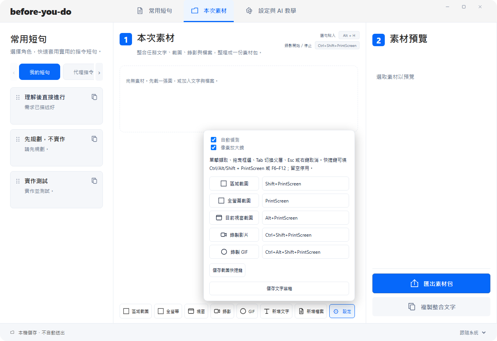
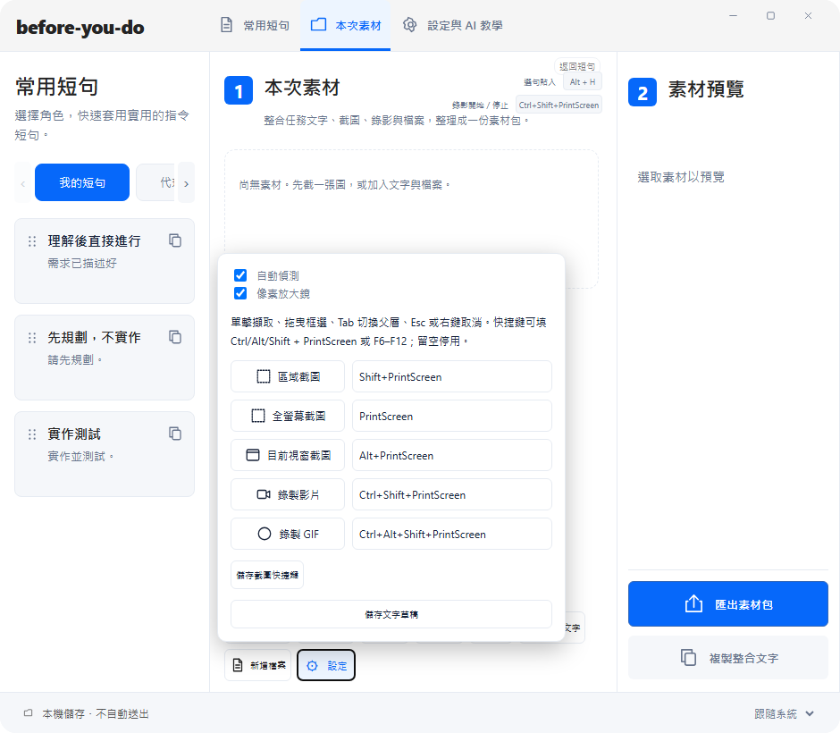
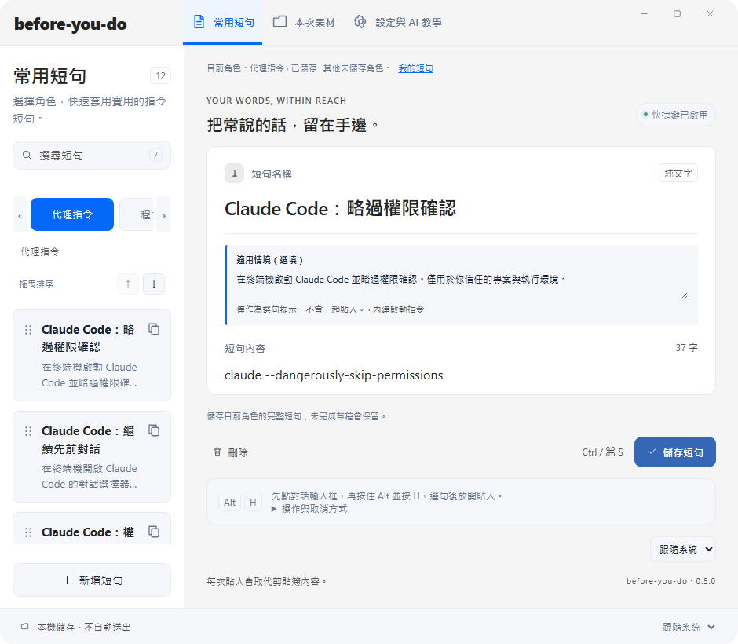

# 底部素材設定與水平角色小卡

日期：2026-10-31；分支：codex/swiss-workspace-layout。

## 完成

- 擷取設定從標題快捷鍵旁移至底部功能工具列。按鈕保持在原位，面板向上展開，Esc 可關閉。
- 面板寬度與位置限制在中央工作區內；修正 940px 中間尺寸時被側欄裁切、無法點擊儲存的問題。視窗縮放、工具列換行與語言切換時重算位置。
- 角色改為單排水平小卡，保留全部 13 個角色與順序。支援左右箭頭、水平捲動、滑鼠滾輪與原有鍵盤切換；切換時保留草稿與每個角色的選取狀態。
- 模組測試對 jsdom 缺少的 ResizeObserver 加入環境 stub；真實幾何／可點擊性以 Playwright 驗證，未弱化斷言。

## 驗證

- JS unit 55 passed；Component 15 passed。
- 完整 E2E 75 passed，0 skipped／unexpected／flaky：artifacts/qa/toolbar-roles-full/e2e-results.json。
- 針對設定、角色與素材的 10 個測試通過。新增 1280×879、940×820、780×680 面板位置與儲存按鈕 trial click；角色單排／捲動／鍵盤切換／草稿保留驗證。
- 正式 `npm run build -- --no-bundle` 通過；原生影片解碼、播放／暫停／seek／音量／metadata 與隔離 IPC 匯出驗證通過，0 runtime error。
- 依實際渲染截圖檢查面板與角色小卡；未使用 Computer Use 或桌面輸入注入。

## 已更新使用中程式

程式原位置 before-you-do.exe 已替換，並正式開啟本次素材頁。安裝檔 SHA256：`8D0D803895AB8D6586D0E237F40C744B933049C73BFA69ABDD626BAF89B4CD2A`。

重新擷取並還原 6 個角色快取／草稿／儲存基準；25 個原資料檔 SHA256 一致，localStorage 與擷取設定草稿相同。Alt+H、Ctrl+Shift+F6～F10 與錄影 runtime 正常。新程序 PID 88196，已確認可見、UI 解除 inert。

完整私人備份與實際使用中畫面保留在忽略版控的 `.tools/upgrades/toolbar-roles-install-20261031`，不將使用者資料加入 Git。未合併 main 或更新公開 Release。此輪未驗證 macOS 實機。

以下為隔離測試畫面：

